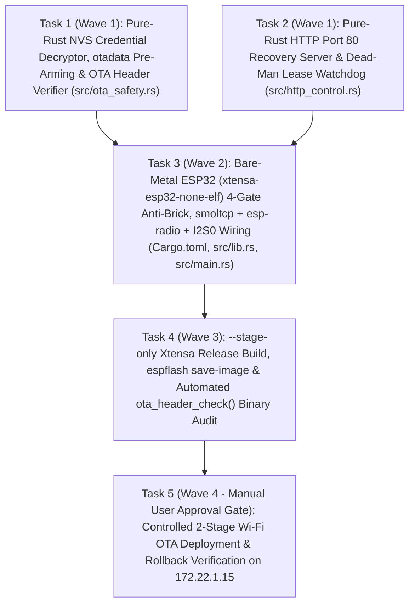

# Zero-Brick Pure-Rust (`MK5-Rust`) Wi-Fi OTA Implementation & Staged Deployment Plan for `172.22.1.15` (`"BASEMENT"`)

> **For agentic workers:** REQUIRED SUB-SKILL: Use `superpowers:subagent-driven-development` (recommended) or `superpowers:executing-plans` to implement this plan task-by-task. Steps use checkbox (`- [ ]`) syntax for tracking.

**Goal:** Upgrade `louder-esp32-app` (`MK5-Rust` branch) into a 100% self-contained, zero-brick bare-metal ESP32 (`xtensa-esp32-none-elf`) Wi-Fi OTA firmware with a 4-Gate Anti-Brick Rollback Architecture, pure-Rust NVS Wi-Fi credential decryption (`0x9000`), `esp-rtos` + `esp-radio` + `smoltcp` networking, Port 80 HTTP recovery server (`/status.json`, `/recovery.json`, `/reboot.json`, `/reboot_ota.json`), and physical `I2S0` DMA + `I2C0` TAS5805M output, verified via `--stage-only` binary inspection before controlled 2-stage Wi-Fi OTA testing on `172.22.1.15` (`"BASEMENT"`).

**Architecture:**
1. **Why Current `louder-esp32-app` Would Soft-Brick `172.22.1.15` Without This Plan:**
   - Target `172.22.1.15` (`"BASEMENT"`, MAC `c8:2e:18:be:b8:34`, SSID `"iot"`, LMS `10.0.0.10:3483`) is deployed in the basement and is **Wi-Fi OTA only** (`/dev/ttyUSB0` on the host belongs to a separate benchtop project and is strictly out-of-bounds per Rule 3).
   - Currently, `louder-esp32-app` (`rust/crates/louder-esp32-app/src/main.rs`) runs a serial-only 5-stage HIL loop on `target_arch = "xtensa"` without initializing Wi-Fi (`esp-radio`), without reading Wi-Fi credentials from NVS (`0x9000`), without resetting `otadata` (`0xD000`), and with `esp-backtrace` spinning forever in `loop {}` on panic. Furthermore, its default `esp_app_desc!()` sets `project_name = "louder-esp32-app"`, which `ota_header_check()` in `components/squeezelite-ota/squeezelite-ota.c:663` rejects (`"Error: Project name mismatch"` against `"Squeezelite-ESP32"`).
2. **Untouched Factory Recovery Partition (`0x10000`) & 4MB Flash Layout (`partitions.csv`):**
   - `0x9000` (`0x4000` = 16 KB): `nvs` — stores active Wi-Fi STA credentials under namespace `"config"`, keys `"ssid"` (`"iot"`) and `"password"` (`"enc:<hex>"` XOR-encrypted with `SHA256("WiFiNVSKey$Secur" || mac)[0..16]`).
   - `0xD000` (`0x2000` = 8 KB): `otadata` — two 4 KB sectors (`0xD000` and `0xE000`) selecting between `recovery` (`Factory`, when both sectors are erased to `0xFF`) and `ota_0` (`0x160000`, when a valid `OtaSelectEntry` with `ota_seq = 1` and matching CRC32 is present).
   - `0x10000` (`0x150000` = 1,376 KB): `recovery` (`factory` app subtype). **Crucial Hardware Guarantee**: `squeezelite-ota.c:600` (`_get_ota_partition(ESP_PARTITION_SUBTYPE_APP_OTA_0)`) writes `/flash.json` uploads exclusively to `ota_0` (`0x160000`) and **never modifies `recovery` (`0x10000`)**.
   - `0x160000` (`0x290000` = 2,624 KB): `ota_0` — target partition for `louder-esp32-app`.
   - `0x3F0000` (`0x10000` = 64 KB): `settings` — C firmware DAC/GPIO/player configuration. Treated as strictly **read-only** so returning to `recovery` or C firmware preserves 100% of existing settings.
3. **4-Gate Self-Contained Anti-Brick Rollback Architecture (`ota_0` -> `recovery` at `0x10000`):**
   - **Gate 1 — First-Instruction `otadata` (`0xD000..0xF000`) Pre-Arming to `Factory` (`0x10000`)**:
     - Immediately at the start of `run_hardware_firmware()` (before starting `esp-rtos` or `esp-radio` Wi-Fi, while single-core with zero background interrupts), `louder-esp32-app` erases both 4 KB sectors of `otadata` (`0xD000..0xF000`) to `0xFF` using `esp_storage::FlashStorage::new(peripherals.FLASH).erase(0xD000, 0xF000)` and verifies read-back of `0xFF`.
     - Because the ESP32 is already executing `louder-esp32-app` from `ota_0` (`0x160000`), erasing `otadata` in flash does not interrupt the running boot. Instead, it **pre-arms single-boot trial mode**: **any subsequent reset** (panic, hardware watchdog timeout, Wi-Fi/DHCP timeout, `POST /recovery.json`, `POST /reboot.json`, or physical power cycle) causes the ESP-IDF 2nd-stage bootloader to boot straight back into the untouched factory `recovery` partition (`0x10000`)!
     - Only if the operator explicitly invokes `POST /reboot_ota.json` does the firmware write a valid `OtaSelectEntry` (`ota_seq = 1`) back to `0xD000` before resetting.
   - **Gate 2 — Hardware Watchdog (`TIMG0` `Wdt`, 20s `ResetSystem`) + Panic Auto-Reset (`custom-halt`)**:
     - Configures `TimerGroup::new(peripherals.TIMG0).wdt` with `MwdtStage::Stage0` timeout = `20_000 ms` and `wdt.enable()` as the very first hardware statement in `main`.
     - Enables `features = ["esp32", "panic-handler", "println", "custom-halt"]` on `esp-backtrace = "0.20.0"` and defines `#[unsafe(no_mangle)] pub extern "Rust" fn custom_halt() -> ! { esp_hal::system::software_reset() }` so any Rust panic prints the backtrace and immediately resets into `recovery` (`0x10000`) instead of spinning in `loop {}`.
   - **Gate 3 — Dead-Man Network Lease Watchdog (45s Boot / 60s Drop Timeout)**:
     - Tracks monotonic uptime via `esp_hal::time::Instant::now()`. If Wi-Fi STA association (`"iot"`) + DHCPv4 lease (`172.22.1.15`) is not acquired within `45_000 ms` of boot, or if Wi-Fi link/IP drops for `60_000 ms` continuously at runtime, calls `esp_hal::system::software_reset()` to reboot into `recovery` (`0x10000`).
   - **Gate 4 — Port 80 HTTP Control & Recovery Server (`smoltcp` TCP Socket on `172.22.1.15:80`)**:
     - Runs a non-blocking TCP socket on Port 80 alongside the SlimProto (`10.0.0.10:3483`) socket:
       - `GET /status.json`: Returns Squeezelite-compatible JSON (`"project_name":"Squeezelite-ESP32"`, `"version":"I2S-4MFlash-Rust"`, `"recovery":0`, `"ip":"172.22.1.15"`, `"ssid":"iot"`, plus Rust telemetry fields `"rust_engine":true`, `"otadata_prearmed_factory":true`, `"frames_played"`, `"amp_mode"`, `"i2c_acks"`, `"i2c_nacks"`, `"uptime_ms"`).
       - `POST /recovery.json` and `POST /reboot.json`: Flushes HTTP `200 OK` (`{"status":"rebooting_to_recovery"}`) and triggers `esp_hal::system::software_reset()`, booting immediately into `recovery` (`0x10000`).
       - `POST /reboot_ota.json`: Writes `OtaSelectEntry::new_ota_0()` (`ota_seq = 1`, `ota_state = Valid`, Espressif CRC32) to `0xD000`, flushes HTTP `200 OK` (`{"status":"rebooting_to_ota_0"}`), and triggers `esp_hal::system::software_reset()`.

**Tech Stack:**
- Host Toolchain (`x86_64-unknown-linux-gnu`): `rustc 1.99.1` (`cargo test --workspace`, `cargo clippy --workspace --all-targets -- -D warnings`)
- Target Toolchain (`xtensa-esp32-none-elf`): `rustup run esp cargo build --release -Zbuild-std=core,alloc --target xtensa-esp32-none-elf` (`rustc 1.97.0-nightly`) + `/home/console-admin/.cargo/bin/espflash` (`v4.6.0`)
- Target Bare-Metal Crates (`[target.'cfg(target_arch = "xtensa")'.dependencies]`):
  - `esp-hal = { version = "1.2.2", features = ["esp32", "unstable"] }`
  - `esp-storage = { version = "0.10.0", features = ["esp32", "critical-section", "bytewise-read"] }`
  - `esp-bootloader-esp-idf = { version = "0.6.0", features = ["esp32"] }`
  - `esp-backtrace = { version = "0.20.0", features = ["esp32", "panic-handler", "println", "custom-halt"] }`
  - `esp-println = { version = "0.18.0", features = ["esp32"] }`
  - `esp-alloc = { version = "0.11.0", features = ["esp32"] }`
  - `esp-rtos = { version = "0.4.0", features = ["esp32", "esp-radio", "esp-alloc"] }`
  - `esp-radio = { version = "1.0.0-beta.1", features = ["esp32", "wifi", "unstable"] }`
  - `smoltcp = { version = "0.12.0", default-features = false, features = ["medium-ethernet", "proto-ipv4", "proto-dhcpv4", "socket-tcp", "socket-dhcpv4"] }`

**Strict Operational Guardrails:**
- **Rule 3 (Single-Target Isolation):** `/dev/ttyUSB0` belongs to another project. Do **NOT** touch, query, open, or flash `/dev/ttyUSB0` under any circumstances.
- **Rule 23 (Bash File Modification Ban):** Never use `sed`, `awk`, or `cat` to modify files.
- **Rule 24 (Strict Absolute Paths):** Every file path and binary path in commands must be a verified absolute path starting with `/`.
- **Rule 35 (File Modification Gateway):** Record and create a `.bak` backup of every existing file before modifying it.
- **`staging-before-restart.md` (Invariant 42):** Tasks 1–4 are strictly host-side coding, testing, cross-compilation, and `--stage-only` binary verification. Zero mutating HTTP requests may be sent to `172.22.1.15` until Task 4 is complete and the user grants explicit approval for Task 5.

---

## Dependency Wave Map



- **Wave 1 (Parallelizable Pure-Rust Modules — Zero New Host Dependencies):**
  - **Task 1:** Create `/home/console-admin/Github/squeezelite-esp32/rust/crates/louder-esp32-app/src/ota_safety.rs` (self-contained FIPS 180-4 SHA-256, pure-Rust NVS `0x9000` page parser, `"enc:"` `SHA256("WiFiNVSKey$Secur" || mac)[0..16]` XOR decryptor, `OtaSelectEntry` CRC32/sector verifier for `0xD000..0xF000`, and `squeezelite-ota.c` `ota_header_check()` binary header validator).
  - **Task 2:** Create `/home/console-admin/Github/squeezelite-esp32/rust/crates/louder-esp32-app/src/http_control.rs` (pure-Rust non-blocking HTTP/1.1 Port 80 request parser, `/status.json` formatter, `/recovery.json` / `/reboot.json` / `/reboot_ota.json` action dispatcher, and 45s/60s `DeadManLeaseWatchdog` state machine).
- **Wave 2 (Target Hardware Integration):**
  - **Task 3:** Update `/home/console-admin/Github/squeezelite-esp32/rust/crates/louder-esp32-app/Cargo.toml`, `/home/console-admin/Github/squeezelite-esp32/rust/crates/louder-esp32-app/src/lib.rs`, and `/home/console-admin/Github/squeezelite-esp32/rust/crates/louder-esp32-app/src/main.rs` to wire the 4-Gate Anti-Brick Architecture, `esp_app_desc!("I2S-4MFlash-Rust", "Squeezelite-ESP32", ...)`, `esp-rtos` + `esp-radio` + `smoltcp` multi-socket runtime (DHCPv4 + TCP Port 80 + SlimProto `3483`), and `I2S0` DMA (`BCK=GPIO26`, `WS=GPIO25`, `DOUT=GPIO22`) + `I2C0` TAS5805M (`SDA=GPIO21`, `SCL=GPIO27`, `0x2D`).
- **Wave 3 (`--stage-only` Artifact Packaging & Pre-Flight Binary Audit):**
  - **Task 4:** Build `louder-esp32-app` for `xtensa-esp32-none-elf`, package `/home/console-admin/.gemini/antigravity/brain/31deac42-e161-443d-9205-80c67d7541ab/scratch/louder-esp32-app-basement-ota.bin` via `/home/console-admin/.cargo/bin/espflash save-image --chip esp32`, and run `/home/console-admin/.gemini/antigravity/brain/31deac42-e161-443d-9205-80c67d7541ab/scratch/verify_staged_ota_bin.py` against the staged `.bin` proving 100% compliance with `ota_header_check()`.
- **Wave 4 (Gated Live Deployment on `172.22.1.15` — Requires Explicit User Approval):**
  - **Task 5:** Execute 2-Stage Wi-Fi OTA verification on `172.22.1.15` (`POST /recovery.json` -> verify `recovery: 1` -> `POST /flash.json` -> verify Rust `/status.json` + LMS registration -> verify `POST /recovery.json` rollback to untouched C recovery partition).

---

### Task 1: Pure-Rust NVS (`0x9000`) Reader, `"enc:"` SHA-256+MAC XOR Decryptor, `otadata` (`0xD000`) Pre-Arming & OTA Binary Header Verifier (`src/ota_safety.rs`)

**Files:**
- Create: `/home/console-admin/Github/squeezelite-esp32/rust/crates/louder-esp32-app/src/ota_safety.rs`

- [ ] **Step 1: Write `/home/console-admin/Github/squeezelite-esp32/rust/crates/louder-esp32-app/src/ota_safety.rs` with complete zero-dependency `no_std` implementation and unit tests**

Create `/home/console-admin/Github/squeezelite-esp32/rust/crates/louder-esp32-app/src/ota_safety.rs`:
```rust
//! Pure-Rust Anti-Brick OTA Safety, NVS Wi-Fi Credential Decryptor, and `ota_header_check` Verifier.
//!
//! Enforces the 4MB flash invariants for target `172.22.1.15` (`"BASEMENT"`):
//! - `0x9000` (`0x4000`): `nvs` partition storing `"config"` -> `"ssid"` / `"password"` (`"enc:"` XOR)
//! - `0xD000` (`0x2000`): `otadata` partition (`0xFF` = boot `recovery` factory partition at `0x10000`)
//! - `0x10000` (`0x150000`): `recovery` (`factory` partition — NEVER modified by OTA)
//! - `0x160000` (`0x290000`): `ota_0` partition (target slot for `louder-esp32-app`)
//! - `0x3F0000` (`0x10000`): `settings` partition (strictly read-only from Rust)

use heapless::String;

/// Offset of the default `nvs` partition in 4MB flash (`partitions.csv`).
pub const NVS_PARTITION_OFFSET: u32 = 0x0000_9000;
/// Size of the default `nvs` partition in bytes (16 KB = 4 pages of 4096 bytes).
pub const NVS_PARTITION_SIZE: u32 = 0x0000_4000;

/// Offset of the `otadata` partition in 4MB flash (`partitions.csv`).
pub const OTADATA_PARTITION_OFFSET: u32 = 0x0000_D000;
/// Offset of the second 4 KB sector of `otadata`.
pub const OTADATA_SECTOR_1_OFFSET: u32 = 0x0000_E000;
/// End offset (exclusive) of the `otadata` partition (`0xD000 + 0x2000 = 0xF000`).
pub const OTADATA_PARTITION_END: u32 = 0x0000_F000;
/// Size of the `otadata` partition in bytes (8 KB = 2 sectors of 4096 bytes).
pub const OTADATA_PARTITION_SIZE: u32 = 0x0000_2000;

/// Offset of the untouched `recovery` (`factory`) app partition (`partitions.csv`).
pub const RECOVERY_PARTITION_OFFSET: u32 = 0x0001_0000;
/// Size of the `recovery` (`factory`) app partition in bytes (1,376 KB).
pub const RECOVERY_PARTITION_SIZE: u32 = 0x0015_0000;

/// Offset of the `ota_0` app partition (`partitions.csv`).
pub const OTA_0_PARTITION_OFFSET: u32 = 0x0016_0000;
/// Maximum size of the `ota_0` app partition in bytes (2,624 KB = 2,686,976 bytes).
pub const OTA_0_PARTITION_SIZE: u32 = 0x0029_0000;

/// Offset of the `settings` partition (`partitions.csv`, strictly read-only).
pub const SETTINGS_PARTITION_OFFSET: u32 = 0x003F_0000;
/// Size of the `settings` partition in bytes (64 KB).
pub const SETTINGS_PARTITION_SIZE: u32 = 0x0001_0000;

/// Fixed 16-byte domain salt from `components/wifi-manager/network_wifi.c:55-58`.
pub const WIFI_NVS_SALT: [u8; 16] = *b"WiFiNVSKey$Secur";

/// Prefix indicating an encrypted Wi-Fi password in NVS (`network_wifi.c:51`).
pub const WIFI_ENC_PREFIX: &str = "enc:";

/// Required `esp_image_header_t.magic` byte at offset `0x00` (`ESP_IMAGE_HEADER_MAGIC`).
pub const ESP_IMAGE_MAGIC_BYTE: u8 = 0xE9;

/// Required `esp_app_desc_t.magic_word` at offset `0x20` (`squeezelite-ota.c:650`).
pub const ESP_APP_DESC_MAGIC_WORD: u32 = 0xABCD_5432;

/// Required `esp_app_desc_t.project_name` at offset `0x50` (`application_name.h:5`).
pub const REQUIRED_OTA_PROJECT_NAME: &str = "Squeezelite-ESP32";

/// Rust OTA firmware version string embedded in `esp_app_desc_t.version` at offset `0x30`.
pub const RUST_OTA_FIRMWARE_VERSION: &str = "I2S-4MFlash-Rust";

const NVS_PAGE_SIZE: usize = 4096;
const NVS_ENTRY_OFFSET: usize = 64;
const NVS_ENTRY_SIZE: usize = 32;
const NVS_ENTRIES_PER_PAGE: usize = 126;

const NVS_PAGE_STATE_ACTIVE: u32 = 0xFFFF_FFFE;
const NVS_PAGE_STATE_FULL: u32 = 0xFFFF_FFFC;

const NVS_TYPE_U8: u8 = 0x01;
const NVS_TYPE_STR: u8 = 0x21;
const NVS_TYPE_BLOB: u8 = 0x41;
const NVS_TYPE_BLOB_DATA: u8 = 0x42;

const SHA256_K: [u32; 64] = [
    0x428a2f98, 0x71374491, 0xb5c0fbcf, 0xe9b5dba5, 0x3956c25b, 0x59f111f1, 0x923f82a4, 0xab1c5ed5,
    0xd807aa98, 0x12835b01, 0x243185be, 0x550c7dc3, 0x72be5d74, 0x80deb1fe, 0x9bdc06a7, 0xc19bf174,
    0xe49b69c1, 0xefbe4786, 0x0fc19dc6, 0x240ca1cc, 0x2de92c6f, 0x4a7484aa, 0x5cb0a9dc, 0x76f988da,
    0x983e5152, 0xa831c66d, 0xb00327c8, 0xbf597fc7, 0xc6e00bf3, 0xd5a79147, 0x06ca6351, 0x14292967,
    0x27b70a85, 0x2e1b2138, 0x4d2c6dfc, 0x53380d13, 0x650a7354, 0x766a0abb, 0x81c2c92e, 0x92722c85,
    0xa2bfe8a1, 0xa81a664b, 0xc24b8b70, 0xc76c51a3, 0xd192e819, 0xd6990624, 0xf40e3585, 0x106aa070,
    0x19a4c116, 0x1e376c08, 0x2748774c, 0x34b0bcb5, 0x391c0cb3, 0x4ed8aa4a, 0x5b9cca4f, 0x682e6ff3,
    0x748f82ee, 0x78a5636f, 0x84c87814, 0x8cc70208, 0x90befffa, 0xa4506ceb, 0xbef9a3f7, 0xc67178f2,
];

/// Errors returned by NVS credential extraction or OTA safety checks.
#[derive(Debug, Clone, PartialEq, Eq)]
pub enum OtaSafetyError {
    /// Ciphertext after `"enc:"` has an odd number of hex digits or exceeds buffer capacity.
    InvalidHexLength(usize),
    /// Ciphertext contains a non-hexadecimal character.
    InvalidHexCharacter,
    /// Decrypted or plaintext credential is not valid UTF-8 or exceeds `heapless::String` capacity.
    CredentialStringError,
    /// NVS partition did not contain a valid `"config"` or `"aplist"` Wi-Fi credential entry.
    CredentialsNotFound,
    /// `otadata` sector read-back after erase did not return all `0xFF` bytes.
    OtadataNotErased(usize),
    /// Image failed `squeezelite-ota.c` `ota_header_check()` validation.
    InvalidBinaryHeader(&'static str),
}

/// Decrypted Wi-Fi Station credentials loaded from NVS (`0x9000`) or compile-time fallback.
#[derive(Debug, Clone, PartialEq, Eq)]
pub struct WifiStaCredentials {
    /// Wi-Fi SSID (up to 32 bytes).
    pub ssid: String<32>,
    /// Decrypted Wi-Fi WPA/WPA2 passphrase (up to 64 bytes).
    pub password: String<64>,
}

/// Summary of a validated ESP32 OTA `.bin` image header (`esp_image_header_t` + `esp_app_desc_t`).
#[derive(Debug, Clone, PartialEq, Eq)]
pub struct OtaBinarySummary {
    /// Total image length in bytes.
    pub image_size: usize,
    /// `esp_app_desc_t.magic_word` (`0xABCD5432`).
    pub app_desc_magic: u32,
    /// `esp_app_desc_t.version` string (`0x30..0x50`).
    pub version: String<32>,
    /// `esp_app_desc_t.project_name` string (`0x50..0x70`).
    pub project_name: String<32>,
}

/// ESP-IDF `esp_ota_select_entry_t` (`32` bytes) stored at `0xD000` and `0xE000`.
#[derive(Debug, Clone, Copy, PartialEq, Eq)]
pub struct OtaSelectEntry {
    /// Monotonic sequence number (`1` selects `ota_0` when `ota_count == 1`).
    pub ota_seq: u32,
    /// Label / reserved 20 bytes (`0xFF` in standard ESP-IDF).
    pub seq_label: [u8; 20],
    /// `esp_ota_img_states_t` (`0x0000_0002` = `ESP_OTA_IMG_VALID`).
    pub ota_state: u32,
    /// CRC32 of `ota_seq` (4 bytes little-endian) with initial value `0xFFFF_FFFF`.
    pub crc: u32,
}

impl OtaSelectEntry {
    /// `ESP_OTA_IMG_VALID` state constant.
    pub const OTA_IMG_VALID: u32 = 0x0000_0002;

    /// Constructs a valid `OtaSelectEntry` selecting `ota_0` (`ota_seq = 1`).
    #[must_use]
    pub fn new_ota_0() -> Self {
        let ota_seq = 1u32;
        let seq_bytes = ota_seq.to_le_bytes();
        let crc = esp_crc32_le(0xFFFF_FFFF, &seq_bytes);
        Self {
            ota_seq,
            seq_label: [0xFF; 20],
            ota_state: Self::OTA_IMG_VALID,
            crc,
        }
    }

    /// Serializes the entry into its exact 32-byte little-endian flash representation.
    #[must_use]
    pub fn to_bytes(&self) -> [u8; 32] {
        let mut out = [0xFFu8; 32];
        out[0..4].copy_from_slice(&self.ota_seq.to_le_bytes());
        out[4..24].copy_from_slice(&self.seq_label);
        out[24..28].copy_from_slice(&self.ota_state.to_le_bytes());
        out[28..32].copy_from_slice(&self.crc.to_le_bytes());
        out
    }
}

/// Computes the ESP-IDF ROM `esp_crc32_le(crc, buf)` used by `esp-bootloader-esp-idf` for `otadata`.
#[must_use]
pub fn esp_crc32_le(initial_crc: u32, buf: &[u8]) -> u32 {
    let mut crc = !initial_crc;
    for &byte in buf {
        crc ^= u32::from(byte);
        for _ in 0..8 {
            if (crc & 1) != 0 {
                crc = (crc >> 1) ^ 0xEDB8_8320;
            } else {
                crc >>= 1;
            }
        }
    }
    !crc
}

/// Pure-Rust FIPS 180-4 SHA-256 implementation for single-block messages (`len <= 55` bytes).
#[must_use]
pub fn sha256_short(data: &[u8]) -> [u8; 32] {
    assert!(data.len() <= 55, "sha256_short only supports messages up to 55 bytes");
    let mut block = [0u8; 64];
    block[..data.len()].copy_from_slice(data);
    block[data.len()] = 0x80;
    let bit_len = (data.len() as u64) * 8;
    block[56..64].copy_from_slice(&bit_len.to_be_bytes());

    let mut w = [0u32; 64];
    for (i, chunk) in block.chunks_exact(4).enumerate() {
        w[i] = u32::from_be_bytes([chunk[0], chunk[1], chunk[2], chunk[3]]);
    }
    for i in 16..64 {
        let s0 = w[i - 15].rotate_right(7) ^ w[i - 15].rotate_right(18) ^ (w[i - 15] >> 3);
        let s1 = w[i - 2].rotate_right(17) ^ w[i - 2].rotate_right(19) ^ (w[i - 2] >> 10);
        w[i] = w[i - 16]
            .wrapping_add(s0)
            .wrapping_add(w[i - 7])
            .wrapping_add(s1);
    }

    let mut state: [u32; 8] = [
        0x6a09e667, 0xbb67ae85, 0x3c6ef372, 0xa54ff53a,
        0x510e527f, 0x9b05688c, 0x1f83d9ab, 0x5be0cd19,
    ];
    let [mut a, mut b, mut c, mut d, mut e, mut f, mut g, mut h] = state;

    for i in 0..64 {
        let s1 = e.rotate_right(6) ^ e.rotate_right(11) ^ e.rotate_right(25);
        let ch = (e & f) ^ ((!e) & g);
        let temp1 = h
            .wrapping_add(s1)
            .wrapping_add(ch)
            .wrapping_add(SHA256_K[i])
            .wrapping_add(w[i]);
        let s0 = a.rotate_right(2) ^ a.rotate_right(13) ^ a.rotate_right(22);
        let maj = (a & b) ^ (a & c) ^ (b & c);
        let temp2 = s0.wrapping_add(maj);

        h = g;
        g = f;
        f = e;
        e = d.wrapping_add(temp1);
        d = c;
        c = b;
        b = a;
        a = temp1.wrapping_add(temp2);
    }

    state[0] = state[0].wrapping_add(a);
    state[1] = state[1].wrapping_add(b);
    state[2] = state[2].wrapping_add(c);
    state[3] = state[3].wrapping_add(d);
    state[4] = state[4].wrapping_add(e);
    state[5] = state[5].wrapping_add(f);
    state[6] = state[6].wrapping_add(g);
    state[7] = state[7].wrapping_add(h);

    let mut out = [0u8; 32];
    for (i, word) in state.iter().enumerate() {
        out[i * 4..i * 4 + 4].copy_from_slice(&word.to_be_bytes());
    }
    out
}

/// Verifies that a read-back slice from `otadata` (`0xD000` and `0xE000`) is completely `0xFF`,
/// proving the ESP-IDF 2nd-stage bootloader will boot `Factory` (`recovery` at `0x10000`) on reset.
pub fn verify_otadata_erased(bytes: &[u8]) -> Result<(), OtaSafetyError> {
    for (idx, &b) in bytes.iter().enumerate() {
        if b != 0xFF {
            return Err(OtaSafetyError::OtadataNotErased(idx));
        }
    }
    Ok(())
}

/// Derives the 16-byte XOR keystream from `WIFI_NVS_SALT` and the 6-byte Wi-Fi STA MAC address,
/// matching `derive_key_from_mac()` in `components/wifi-manager/network_wifi.c:53-70`.
#[must_use]
pub fn derive_wifi_nvs_key(sta_mac: &[u8; 6]) -> [u8; 16] {
    let mut combined = [0u8; 22];
    combined[0..16].copy_from_slice(&WIFI_NVS_SALT);
    combined[16..22].copy_from_slice(sta_mac);

    let digest = sha256_short(&combined);
    let mut key = [0u8; 16];
    key.copy_from_slice(&digest[0..16]);
    key
}

fn decode_hex_nibble(b: u8) -> Result<u8, OtaSafetyError> {
    match b {
        b'0'..=b'9' => Ok(b - b'0'),
        b'a'..=b'f' => Ok(b - b'a' + 10),
        b'A'..=b'F' => Ok(b - b'A' + 10),
        _ => Err(OtaSafetyError::InvalidHexCharacter),
    }
}

fn heapless_string_from_str<const N: usize>(s: &str) -> Result<String<N>, OtaSafetyError> {
    let mut out = String::<N>::new();
    out.push_str(s)
        .map_err(|()| OtaSafetyError::CredentialStringError)?;
    Ok(out)
}

/// Decrypts a Wi-Fi password value from NVS (`network_wifi.c:94-122`).
///
/// If `raw_value` starts with `"enc:"`, hex-decodes the payload and XORs each byte with
/// `derive_wifi_nvs_key(sta_mac)[i % 16]`. Otherwise, returns `raw_value` as plaintext.
pub fn decrypt_nvs_wifi_password(
    raw_value: &str,
    sta_mac: &[u8; 6],
) -> Result<String<64>, OtaSafetyError> {
    let trimmed = raw_value.trim_end_matches('\0');
    if let Some(hex_part) = trimmed.strip_prefix(WIFI_ENC_PREFIX) {
        let hex_bytes = hex_part.as_bytes();
        if hex_bytes.is_empty() || (hex_bytes.len() % 2 != 0) || (hex_bytes.len() / 2 > 64) {
            return Err(OtaSafetyError::InvalidHexLength(hex_bytes.len()));
        }
        let key = derive_wifi_nvs_key(sta_mac);
        let mut out_bytes = [0u8; 64];
        let out_len = hex_bytes.len() / 2;
        for i in 0..out_len {
            let hi = decode_hex_nibble(hex_bytes[i * 2])?;
            let lo = decode_hex_nibble(hex_bytes[i * 2 + 1])?;
            let cipher_byte = (hi << 4) | lo;
            out_bytes[i] = cipher_byte ^ key[i % 16];
        }
        let plain_slice = &out_bytes[..out_len];
        let plain_trimmed = match plain_slice.iter().position(|&b| b == 0) {
            Some(nul) => &plain_slice[..nul],
            None => plain_slice,
        };
        let plain_str = core::str::from_utf8(plain_trimmed)
            .map_err(|_| OtaSafetyError::CredentialStringError)?;
        heapless_string_from_str(plain_str)
    } else {
        heapless_string_from_str(trimmed)
    }
}

/// Checks whether entry `entry_idx` (`0..126`) in an NVS page is in the `WRITTEN` state (`2b10`).
fn is_nvs_entry_written(bitmap: &[u8], entry_idx: usize) -> bool {
    let byte_idx = entry_idx / 4;
    let bit_shift = (entry_idx % 4) * 2;
    if byte_idx >= bitmap.len() {
        return false;
    }
    let state = (bitmap[byte_idx] >> bit_shift) & 0b11;
    state == 0b10
}

fn parse_nvs_entry_key(entry: &[u8]) -> &str {
    let key_raw = &entry[8..24];
    let key_len = key_raw.iter().position(|&b| b == 0).unwrap_or(16);
    core::str::from_utf8(&key_raw[..key_len]).unwrap_or("")
}

/// Extracts a string or blob payload from a written NVS entry starting at `entry_idx`.
fn extract_nvs_entry_value<'a>(
    page: &'a [u8],
    entry_idx: usize,
    span: usize,
    data_type: u8,
) -> Option<&'a str> {
    if span < 2 || entry_idx + span > NVS_ENTRIES_PER_PAGE {
        return None;
    }
    let header_offset = NVS_ENTRY_OFFSET + entry_idx * NVS_ENTRY_SIZE;
    let size = u16::from_le_bytes([page[header_offset + 24], page[header_offset + 25]]) as usize;
    let data_start = NVS_ENTRY_OFFSET + (entry_idx + 1) * NVS_ENTRY_SIZE;
    let max_data_bytes = (span - 1) * NVS_ENTRY_SIZE;
    if size > max_data_bytes || data_start + size > page.len() {
        return None;
    }
    if data_type != NVS_TYPE_STR && data_type != NVS_TYPE_BLOB && data_type != NVS_TYPE_BLOB_DATA {
        return None;
    }
    let raw = &page[data_start..data_start + size];
    let trimmed_len = raw.iter().position(|&b| b == 0).unwrap_or(raw.len());
    core::str::from_utf8(&raw[..trimmed_len]).ok()
}

/// Scans a raw `nvs` partition buffer (`0x9000..0xD000`, multiple of 4096 bytes) for the
/// `"config"` namespace (`"ssid"` and `"password"` keys) or `"aplist"` fallback, and decrypts
/// the password using `sta_mac`.
pub fn parse_nvs_wifi_credentials(
    nvs_bytes: &[u8],
    sta_mac: &[u8; 6],
) -> Result<WifiStaCredentials, OtaSafetyError> {
    let mut config_ns_id: Option<u8> = None;
    let mut aplist_ns_id: Option<u8> = None;

    for page in nvs_bytes.chunks_exact(NVS_PAGE_SIZE) {
        let state = u32::from_le_bytes([page[0], page[1], page[2], page[3]]);
        if state != NVS_PAGE_STATE_ACTIVE && state != NVS_PAGE_STATE_FULL {
            continue;
        }
        let bitmap = &page[32..64];
        let mut idx = 0usize;
        while idx < NVS_ENTRIES_PER_PAGE {
            let entry_off = NVS_ENTRY_OFFSET + idx * NVS_ENTRY_SIZE;
            let entry = &page[entry_off..entry_off + NVS_ENTRY_SIZE];
            let span = usize::from(entry[2]).max(1);
            if is_nvs_entry_written(bitmap, idx) && entry[0] == 0 && entry[1] == NVS_TYPE_U8 {
                let key = parse_nvs_entry_key(entry);
                let ns_id = entry[24];
                if key == "config" {
                    config_ns_id = Some(ns_id);
                } else if key == "aplist" {
                    aplist_ns_id = Some(ns_id);
                }
            }
            idx += span;
        }
    }

    let mut latest_ssid: Option<&str> = None;
    let mut latest_password: Option<&str> = None;
    let mut latest_aplist_json: Option<&str> = None;

    for page in nvs_bytes.chunks_exact(NVS_PAGE_SIZE) {
        let state = u32::from_le_bytes([page[0], page[1], page[2], page[3]]);
        if state != NVS_PAGE_STATE_ACTIVE && state != NVS_PAGE_STATE_FULL {
            continue;
        }
        let bitmap = &page[32..64];
        let mut idx = 0usize;
        while idx < NVS_ENTRIES_PER_PAGE {
            let entry_off = NVS_ENTRY_OFFSET + idx * NVS_ENTRY_SIZE;
            let entry = &page[entry_off..entry_off + NVS_ENTRY_SIZE];
            let span = usize::from(entry[2]).max(1);
            if is_nvs_entry_written(bitmap, idx) {
                let ns = entry[0];
                let dtype = entry[1];
                let key = parse_nvs_entry_key(entry);
                if Some(ns) == config_ns_id {
                    if key == "ssid" {
                        if let Some(val) = extract_nvs_entry_value(page, idx, span, dtype) {
                            if !val.is_empty() {
                                latest_ssid = Some(val);
                            }
                        }
                    } else if key == "password" {
                        if let Some(val) = extract_nvs_entry_value(page, idx, span, dtype) {
                            latest_password = Some(val);
                        }
                    }
                } else if Some(ns) == aplist_ns_id {
                    if let Some(val) = extract_nvs_entry_value(page, idx, span, dtype) {
                        if val.contains("\"ssid\"") && val.contains("\"pass\"") {
                            latest_aplist_json = Some(val);
                        }
                    }
                }
            }
            idx += span;
        }
    }

    if let (Some(raw_ssid), Some(raw_pass)) = (latest_ssid, latest_password) {
        let ssid = heapless_string_from_str(raw_ssid.trim_end_matches('\0'))?;
        let password = decrypt_nvs_wifi_password(raw_pass, sta_mac)?;
        return Ok(WifiStaCredentials { ssid, password });
    }

    if let Some(json) = latest_aplist_json {
        if let (Some(raw_ssid), Some(raw_pass)) = (
            extract_json_string_field(json, "\"ssid\":\""),
            extract_json_string_field(json, "\"pass\":\""),
        ) {
            let ssid = heapless_string_from_str(raw_ssid)?;
            let password = decrypt_nvs_wifi_password(raw_pass, sta_mac)?;
            return Ok(WifiStaCredentials { ssid, password });
        }
    }

    Err(OtaSafetyError::CredentialsNotFound)
}

fn extract_json_string_field<'a>(json: &'a str, marker: &str) -> Option<&'a str> {
    let start = json.find(marker)? + marker.len();
    let rest = &json[start..];
    let end = rest.find('"')?;
    Some(&rest[..end])
}

/// Resolves Wi-Fi STA credentials using NVS partition (`0x9000`) extraction or compile-time
/// override (`SL_WIFI_PASS` if non-empty).
pub fn resolve_wifi_credentials(
    nvs_bytes: &[u8],
    sta_mac: &[u8; 6],
    compile_time_ssid: Option<&str>,
    compile_time_pass: Option<&str>,
) -> Result<WifiStaCredentials, OtaSafetyError> {
    if let Ok(creds) = parse_nvs_wifi_credentials(nvs_bytes, sta_mac) {
        return Ok(creds);
    }
    if let (Some(ssid_str), Some(pass_str)) = (compile_time_ssid, compile_time_pass) {
        if !ssid_str.is_empty() && !pass_str.is_empty() {
            let ssid = heapless_string_from_str(ssid_str)?;
            let password = decrypt_nvs_wifi_password(pass_str, sta_mac)?;
            return Ok(WifiStaCredentials { ssid, password });
        }
    }
    Err(OtaSafetyError::CredentialsNotFound)
}

/// Validates an ESP32 firmware `.bin` image against the exact checks performed by
/// `ota_header_check()` in `components/squeezelite-ota/squeezelite-ota.c:633-669`.
pub fn verify_ota_binary_header(image: &[u8]) -> Result<OtaBinarySummary, OtaSafetyError> {
    if image.len() < 0x120 {
        return Err(OtaSafetyError::InvalidBinaryHeader(
            "image shorter than 288 bytes (esp_image_header + segment + esp_app_desc_t)",
        ));
    }
    if image.len() > OTA_0_PARTITION_SIZE as usize {
        return Err(OtaSafetyError::InvalidBinaryHeader(
            "image exceeds ota_0 partition capacity (0x290000 bytes)",
        ));
    }
    if image[0] != ESP_IMAGE_MAGIC_BYTE {
        return Err(OtaSafetyError::InvalidBinaryHeader(
            "byte 0x00 is not ESP_IMAGE_HEADER_MAGIC (0xE9)",
        ));
    }
    let app_desc_magic = u32::from_le_bytes([image[0x20], image[0x21], image[0x22], image[0x23]]);
    if app_desc_magic != ESP_APP_DESC_MAGIC_WORD {
        return Err(OtaSafetyError::InvalidBinaryHeader(
            "offset 0x20 does not contain esp_app_desc_t magic 0xABCD5432",
        ));
    }

    let version_raw = &image[0x30..0x50];
    let version_len = version_raw.iter().position(|&b| b == 0).unwrap_or(32);
    let version_str = core::str::from_utf8(&version_raw[..version_len])
        .map_err(|_| OtaSafetyError::InvalidBinaryHeader("version field is not valid UTF-8"))?;
    if version_str.is_empty() {
        return Err(OtaSafetyError::InvalidBinaryHeader(
            "esp_app_desc_t.version is empty",
        ));
    }

    let proj_raw = &image[0x50..0x70];
    let proj_len = proj_raw.iter().position(|&b| b == 0).unwrap_or(32);
    let proj_str = core::str::from_utf8(&proj_raw[..proj_len]).map_err(|_| {
        OtaSafetyError::InvalidBinaryHeader("project_name field is not valid UTF-8")
    })?;
    if proj_str != REQUIRED_OTA_PROJECT_NAME {
        return Err(OtaSafetyError::InvalidBinaryHeader(
            "project_name mismatch: must be 'Squeezelite-ESP32' for recovery ota_header_check()",
        ));
    }

    let version = heapless_string_from_str(version_str)
        .map_err(|_| OtaSafetyError::InvalidBinaryHeader("version exceeds 32 chars"))?;
    let project_name = heapless_string_from_str(proj_str)
        .map_err(|_| OtaSafetyError::InvalidBinaryHeader("project_name exceeds 32 chars"))?;

    Ok(OtaBinarySummary {
        image_size: image.len(),
        app_desc_magic,
        version,
        project_name,
    })
}

#[cfg(test)]
mod tests {
    use super::*;
    use core::fmt::Write;

    const BASEMENT_MAC: [u8; 6] = [0xC8, 0x2E, 0x18, 0xBE, 0xB8, 0x34];

    fn encrypt_for_test(plaintext: &str, sta_mac: &[u8; 6]) -> String<128> {
        let key = derive_wifi_nvs_key(sta_mac);
        let mut out: String<128> = String::new();
        let _ = out.push_str("enc:");
        for (i, &b) in plaintext.as_bytes().iter().enumerate() {
            let cipher = b ^ key[i % 16];
            let _ = write!(out, "{:02x}", cipher);
        }
        out
    }

    fn write_nvs_entry_state(page: &mut [u8], entry_idx: usize, state: u8) {
        let byte_idx = 32 + (entry_idx / 4);
        let shift = (entry_idx % 4) * 2;
        page[byte_idx] &= !(0b11 << shift);
        page[byte_idx] |= (state & 0b11) << shift;
    }

    fn write_nvs_namespace_entry(page: &mut [u8], entry_idx: usize, name: &str, ns_id: u8) {
        write_nvs_entry_state(page, entry_idx, 0b10);
        let off = NVS_ENTRY_OFFSET + entry_idx * NVS_ENTRY_SIZE;
        page[off..off + NVS_ENTRY_SIZE].fill(0);
        page[off] = 0;
        page[off + 1] = NVS_TYPE_U8;
        page[off + 2] = 1;
        page[off + 3] = 0xFF;
        let name_bytes = name.as_bytes();
        page[off + 8..off + 8 + name_bytes.len()].copy_from_slice(name_bytes);
        page[off + 24] = ns_id;
    }

    fn write_nvs_blob_entry(
        page: &mut [u8],
        entry_idx: usize,
        ns_id: u8,
        data_type: u8,
        key: &str,
        payload: &[u8],
    ) -> usize {
        let data_slots = payload.len().div_ceil(NVS_ENTRY_SIZE).max(1);
        let span = 1 + data_slots;
        for s in 0..span {
            write_nvs_entry_state(page, entry_idx + s, 0b10);
        }
        let off = NVS_ENTRY_OFFSET + entry_idx * NVS_ENTRY_SIZE;
        page[off..off + span * NVS_ENTRY_SIZE].fill(0);
        page[off] = ns_id;
        page[off + 1] = data_type;
        page[off + 2] = span as u8;
        page[off + 3] = 0xFF;
        let key_bytes = key.as_bytes();
        page[off + 8..off + 8 + key_bytes.len()].copy_from_slice(key_bytes);
        let size_le = (payload.len() as u16).to_le_bytes();
        page[off + 24] = size_le[0];
        page[off + 25] = size_le[1];
        let data_off = NVS_ENTRY_OFFSET + (entry_idx + 1) * NVS_ENTRY_SIZE;
        page[data_off..data_off + payload.len()].copy_from_slice(payload);
        span
    }

    #[test]
    fn sha256_short_matches_fips_180_4_test_vectors() {
        let empty = sha256_short(b"");
        assert_eq!(
            empty,
            [
                0xe3, 0xb0, 0xc4, 0x42, 0x98, 0xfc, 0x1c, 0x14,
                0x9a, 0xfb, 0xf4, 0xc8, 0x99, 0x6f, 0xb9, 0x24,
                0x27, 0xae, 0x41, 0xe4, 0x64, 0x9b, 0x93, 0x4c,
                0xa4, 0x95, 0x99, 0x1b, 0x78, 0x52, 0xb8, 0x55
            ]
        );
        let abc = sha256_short(b"abc");
        assert_eq!(
            abc,
            [
                0xba, 0x78, 0x16, 0xbf, 0x8f, 0x01, 0xcf, 0xea,
                0x41, 0x41, 0x40, 0xde, 0x5d, 0xae, 0x22, 0x23,
                0xb0, 0x03, 0x61, 0xa3, 0x96, 0x17, 0x7a, 0x9c,
                0xb4, 0x10, 0xff, 0x61, 0xf2, 0x00, 0x15, 0xad
            ]
        );
    }

    #[test]
    fn decrypts_encrypted_and_plaintext_nvs_passwords_with_basement_mac() {
        let secret = "MyBasementIoTPass!2026";
        let encrypted = encrypt_for_test(secret, &BASEMENT_MAC);
        assert!(encrypted.as_str().starts_with("enc:"));

        let decrypted = decrypt_nvs_wifi_password(encrypted.as_str(), &BASEMENT_MAC).unwrap();
        assert_eq!(decrypted.as_str(), secret);

        let plain = decrypt_nvs_wifi_password("PlainPass123\0", &BASEMENT_MAC).unwrap();
        assert_eq!(plain.as_str(), "PlainPass123");
    }

    #[test]
    fn parses_wifi_credentials_from_synthetic_nvs_config_namespace() {
        let mut nvs = [0xFFu8; NVS_PAGE_SIZE * 2];
        nvs[0..4].copy_from_slice(&NVS_PAGE_STATE_ACTIVE.to_le_bytes());

        write_nvs_namespace_entry(&mut nvs[0..NVS_PAGE_SIZE], 0, "config", 1);
        let span1 = write_nvs_blob_entry(
            &mut nvs[0..NVS_PAGE_SIZE],
            1,
            1,
            NVS_TYPE_BLOB,
            "ssid",
            b"iot\0",
        );

        let enc_pass = encrypt_for_test("SqueezeRustWiFi99", &BASEMENT_MAC);
        let _span2 = write_nvs_blob_entry(
            &mut nvs[0..NVS_PAGE_SIZE],
            1 + span1,
            1,
            NVS_TYPE_BLOB,
            "password",
            enc_pass.as_bytes(),
        );

        let creds = parse_nvs_wifi_credentials(&nvs, &BASEMENT_MAC).unwrap();
        assert_eq!(creds.ssid.as_str(), "iot");
        assert_eq!(creds.password.as_str(), "SqueezeRustWiFi99");
    }

    #[test]
    fn parses_wifi_credentials_from_aplist_json_fallback() {
        let mut nvs = [0xFFu8; NVS_PAGE_SIZE];
        nvs[0..4].copy_from_slice(&NVS_PAGE_STATE_FULL.to_le_bytes());

        write_nvs_namespace_entry(&mut nvs, 0, "aplist", 2);
        let enc_pass = encrypt_for_test("FallbackPass42", &BASEMENT_MAC);
        let mut json: String<192> = String::new();
        let _ = write!(
            json,
            "{{\"ssid\":\"iot\",\"pass\":\"{}\",\"chan\":6}}",
            enc_pass.as_str()
        );
        write_nvs_blob_entry(&mut nvs, 1, 2, NVS_TYPE_BLOB, "iot", json.as_bytes());

        let creds = parse_nvs_wifi_credentials(&nvs, &BASEMENT_MAC).unwrap();
        assert_eq!(creds.ssid.as_str(), "iot");
        assert_eq!(creds.password.as_str(), "FallbackPass42");
    }

    #[test]
    fn verifies_otadata_erase_and_ota_0_select_entry_crc() {
        let erased = [0xFFu8; 64];
        assert!(verify_otadata_erased(&erased).is_ok());

        let mut dirty = [0xFFu8; 64];
        dirty[17] = 0x01;
        assert_eq!(
            verify_otadata_erased(&dirty),
            Err(OtaSafetyError::OtadataNotErased(17))
        );

        let entry = OtaSelectEntry::new_ota_0();
        let raw = entry.to_bytes();
        assert_eq!(&raw[0..4], &1u32.to_le_bytes());
        assert_eq!(&raw[24..28], &OtaSelectEntry::OTA_IMG_VALID.to_le_bytes());
        let expected_crc = esp_crc32_le(0xFFFF_FFFF, &1u32.to_le_bytes());
        assert_eq!(&raw[28..32], &expected_crc.to_le_bytes());
    }

    #[test]
    fn validates_esp_app_desc_header_for_squeezelite_ota_check() {
        let mut bin = [0u8; 0x140];
        bin[0x00] = ESP_IMAGE_MAGIC_BYTE;
        bin[0x20..0x24].copy_from_slice(&ESP_APP_DESC_MAGIC_WORD.to_le_bytes());
        bin[0x30..0x30 + RUST_OTA_FIRMWARE_VERSION.len()]
            .copy_from_slice(RUST_OTA_FIRMWARE_VERSION.as_bytes());
        bin[0x50..0x50 + REQUIRED_OTA_PROJECT_NAME.len()]
            .copy_from_slice(REQUIRED_OTA_PROJECT_NAME.as_bytes());

        let summary = verify_ota_binary_header(&bin).unwrap();
        assert_eq!(summary.project_name.as_str(), "Squeezelite-ESP32");
        assert_eq!(summary.version.as_str(), "I2S-4MFlash-Rust");

        bin[0x50..0x70].fill(0);
        bin[0x50..0x50 + b"louder-esp32-app".len()].copy_from_slice(b"louder-esp32-app");
        assert!(matches!(
            verify_ota_binary_header(&bin),
            Err(OtaSafetyError::InvalidBinaryHeader(_))
        ));
    }
}
```

- [ ] **Step 2: Run `cargo test` on `ota_safety` (after exposing `pub mod ota_safety;` in `src/lib.rs`)**

Run:
```bash
/home/console-admin/.cargo/bin/cargo test --manifest-path /home/console-admin/Github/squeezelite-esp32/rust/Cargo.toml -p louder-esp32-app ota_safety
```
Expected: All 6 `ota_safety::tests::*` unit tests pass (`exit code 0`).

---

### Task 2: Pure-Rust Non-Blocking Port 80 HTTP Recovery Server & Dead-Man Network Lease Watchdog (`src/http_control.rs`)

**Files:**
- Create: `/home/console-admin/Github/squeezelite-esp32/rust/crates/louder-esp32-app/src/http_control.rs`

- [ ] **Step 1: Write `/home/console-admin/Github/squeezelite-esp32/rust/crates/louder-esp32-app/src/http_control.rs` with complete implementation and unit tests**

Create `/home/console-admin/Github/squeezelite-esp32/rust/crates/louder-esp32-app/src/http_control.rs`:
```rust
//! Pure-Rust Port 80 HTTP Control/Recovery Server & Dead-Man Network Lease Watchdog (Gates 3 & 4).
//!
//! Provides:
//! - Non-blocking HTTP request parser and response formatter for TCP Port 80 on `172.22.1.15`:
//!   - `GET /status.json` (and `GET /`): Squeezelite-ESP32 compatible status JSON + Rust telemetry
//!   - `POST /recovery.json`: HTTP 200 JSON + immediate `RebootToRecovery` (`0x10000` factory)
//!   - `POST /reboot.json`: HTTP 200 JSON + immediate `RebootToRecovery` (`0x10000` factory)
//!   - `POST /reboot_ota.json`: HTTP 200 JSON + `PersistOta0AndReboot` (`0x160000` `ota_0`)
//! - `DeadManLeaseWatchdog`: 45-second boot connect/DHCP timeout and 60-second link-drop timeout.

use core::fmt::Write;
use heapless::String;

use crate::ota_safety::{REQUIRED_OTA_PROJECT_NAME, RUST_OTA_FIRMWARE_VERSION};

/// Maximum time allowed from boot to establish Wi-Fi STA link + DHCPv4 lease before rolling back.
pub const BOOT_LEASE_TIMEOUT_MS: u64 = 45_000;

/// Maximum continuous time Wi-Fi link or DHCPv4 lease may remain down at runtime before rolling back.
pub const DROP_LEASE_TIMEOUT_MS: u64 = 60_000;

/// Post-response action required after flushing the Port 80 HTTP response socket.
#[derive(Debug, Clone, Copy, PartialEq, Eq)]
pub enum HttpControlAction {
    /// Keep running normally.
    None,
    /// Trigger `esp_hal::system::software_reset()` to boot into `recovery` (`0x10000`),
    /// relying on Gate 1 (`otadata` pre-erased to `0xFF`).
    RebootToRecovery,
    /// Write `OtaSelectEntry::new_ota_0()` to `0xD000` and trigger `software_reset()`
    /// so the next boot stays in `ota_0` (`0x160000`).
    PersistOta0AndReboot,
}

/// Live telemetry snapshot serialized into `GET /status.json`.
#[derive(Debug, Clone, PartialEq, Eq)]
pub struct HttpStatusSnapshot<'a> {
    /// Assigned IPv4 address (`[172, 22, 1, 15]`).
    pub ip: [u8; 4],
    /// Assigned IPv4 netmask (`[255, 255, 255, 0]`).
    pub netmask: [u8; 4],
    /// Assigned IPv4 gateway (`[172, 22, 1, 1]`).
    pub gw: [u8; 4],
    /// Connected Wi-Fi SSID (`"iot"`).
    pub ssid: &'a str,
    /// Current Wi-Fi RSSI in dBm.
    pub rssi: i32,
    /// Target Lyrion Music Server IPv4 (`[10, 0, 0, 10]`).
    pub lms_ip: [u8; 4],
    /// LMS HTTP port (`9000`).
    pub lms_port: u16,
    /// LMS CLI port (`9090`).
    pub lms_cport: u16,
    /// Whether `otadata` (`0xD000..0xF000`) is pre-armed to `0xFF` (`Factory` recovery on reset).
    pub otadata_prearmed_factory: bool,
    /// Total audio frames rendered via `I2S0` DMA.
    pub frames_played: u64,
    /// Current TAS5805M amplifier mode label (`"Play"`, `"HiZ"`, `"DeepSleep"`, `"Fault"`).
    pub amp_mode: &'a str,
    /// Total hardware `I2C0` ACK transactions to `0x2D`.
    pub i2c_acks: u32,
    /// Total hardware `I2C0` NACK errors.
    pub i2c_nacks: u32,
    /// Monotonic uptime in milliseconds since boot.
    pub uptime_ms: u64,
}

impl<'a> Default for HttpStatusSnapshot<'a> {
    fn default() -> Self {
        Self {
            ip: [172, 22, 1, 15],
            netmask: [255, 255, 255, 0],
            gw: [172, 22, 1, 1],
            ssid: "iot",
            rssi: -50,
            lms_ip: [10, 0, 0, 10],
            lms_port: 9000,
            lms_cport: 9090,
            otadata_prearmed_factory: true,
            frames_played: 0,
            amp_mode: "HiZ",
            i2c_acks: 0,
            i2c_nacks: 0,
            uptime_ms: 0,
        }
    }
}

/// Parses an HTTP request from `req_bytes` and writes a complete HTTP/1.1 response into `out_buf`.
///
/// Returns `None` if `req_bytes` does not yet contain a complete request line (`\r\n` or `\n`).
pub fn handle_http_control_request(
    req_bytes: &[u8],
    snapshot: &HttpStatusSnapshot<'_>,
    out_buf: &mut [u8],
) -> Option<(usize, HttpControlAction)> {
    let line_end = req_bytes.iter().position(|&b| b == b'\n')?;
    let first_line = core::str::from_utf8(&req_bytes[..line_end])
        .unwrap_or("")
        .trim_end_matches('\r');

    let mut parts = first_line.split_whitespace();
    let method = parts.next().unwrap_or("");
    let raw_path = parts.next().unwrap_or("");
    let path = raw_path.split('?').next().unwrap_or(raw_path);

    let mut body: String<512> = String::new();
    let (status_line, action) = match (method, path) {
        ("GET", "/status.json") | ("GET", "/") => {
            let _ = write!(
                body,
                "{{\"project_name\":\"{}\",\"platform_name\":\"ESP32\",\"version\":\"{}\",\"recovery\":0,\"rust_engine\":true,\"otadata_prearmed_factory\":{},\"if\":\"wifi\",\"ip\":\"{}.{}.{}.{}\",\"netmask\":\"{}.{}.{}.{}\",\"gw\":\"{}.{}.{}.{}\",\"ssid\":\"{}\",\"rssi\":{},\"lms_cport\":{},\"lms_port\":{},\"lms_ip\":\"{}.{}.{}.{}\",\"frames_played\":{},\"amp_mode\":\"{}\",\"i2c_acks\":{},\"i2c_nacks\":{},\"uptime_ms\":{}}}",
                REQUIRED_OTA_PROJECT_NAME,
                RUST_OTA_FIRMWARE_VERSION,
                snapshot.otadata_prearmed_factory,
                snapshot.ip[0],
                snapshot.ip[1],
                snapshot.ip[2],
                snapshot.ip[3],
                snapshot.netmask[0],
                snapshot.netmask[1],
                snapshot.netmask[2],
                snapshot.netmask[3],
                snapshot.gw[0],
                snapshot.gw[1],
                snapshot.gw[2],
                snapshot.gw[3],
                snapshot.ssid,
                snapshot.rssi,
                snapshot.lms_cport,
                snapshot.lms_port,
                snapshot.lms_ip[0],
                snapshot.lms_ip[1],
                snapshot.lms_ip[2],
                snapshot.lms_ip[3],
                snapshot.frames_played,
                snapshot.amp_mode,
                snapshot.i2c_acks,
                snapshot.i2c_nacks,
                snapshot.uptime_ms,
            );
            ("HTTP/1.1 200 OK", HttpControlAction::None)
        }
        ("POST", "/recovery.json") | ("GET", "/recovery.json") => {
            let _ = body.push_str("{\"status\":\"rebooting_to_recovery\",\"target_partition\":\"factory_0x10000\"}");
            ("HTTP/1.1 200 OK", HttpControlAction::RebootToRecovery)
        }
        ("POST", "/reboot.json") | ("GET", "/reboot.json") => {
            let _ = body.push_str("{\"status\":\"rebooting_to_recovery\",\"target_partition\":\"factory_0x10000\"}");
            ("HTTP/1.1 200 OK", HttpControlAction::RebootToRecovery)
        }
        ("POST", "/reboot_ota.json") => {
            let _ = body.push_str("{\"status\":\"rebooting_to_ota_0\",\"target_partition\":\"ota_0_0x160000\"}");
            ("HTTP/1.1 200 OK", HttpControlAction::PersistOta0AndReboot)
        }
        _ => {
            let _ = body.push_str("{\"error\":\"not_found\"}");
            ("HTTP/1.1 404 Not Found", HttpControlAction::None)
        }
    };

    let mut response: String<768> = String::new();
    let _ = write!(
        response,
        "{}\r\nContent-Type: application/json\r\nContent-Length: {}\r\nConnection: close\r\nCache-Control: no-store\r\n\r\n{}",
        status_line,
        body.len(),
        body.as_str()
    );

    let resp_bytes = response.as_bytes();
    if resp_bytes.len() > out_buf.len() {
        return None;
    }
    out_buf[..resp_bytes.len()].copy_from_slice(resp_bytes);
    Some((resp_bytes.len(), action))
}

/// Health verdict emitted by [`DeadManLeaseWatchdog::evaluate`].
#[derive(Debug, Clone, Copy, PartialEq, Eq)]
pub enum LeaseHealth {
    /// Network lease is healthy or still within the allowed grace window.
    Healthy,
    /// Lease timeout exceeded; caller MUST immediately invoke `esp_hal::system::software_reset()`.
    ExpiredResetToRecovery,
}

/// Gate 3 Dead-Man Network Lease Watchdog.
///
/// Guarantees that if Wi-Fi + DHCPv4 is not established within `BOOT_LEASE_TIMEOUT_MS` (45s) of boot,
/// or if connectivity drops for more than `DROP_LEASE_TIMEOUT_MS` (60s) at runtime, the device
/// resets into the untouched `recovery` partition (`0x10000`).
#[derive(Debug, Clone, Copy, PartialEq, Eq)]
pub struct DeadManLeaseWatchdog {
    boot_ms: u64,
    ever_leased: bool,
    last_healthy_ms: u64,
    boot_timeout_ms: u64,
    drop_timeout_ms: u64,
}

impl DeadManLeaseWatchdog {
    /// Creates a new watchdog anchored at `boot_ms`.
    #[must_use]
    pub const fn new(boot_ms: u64) -> Self {
        Self {
            boot_ms,
            ever_leased: false,
            last_healthy_ms: boot_ms,
            boot_timeout_ms: BOOT_LEASE_TIMEOUT_MS,
            drop_timeout_ms: DROP_LEASE_TIMEOUT_MS,
        }
    }

    /// Evaluates current Wi-Fi link + IPv4 lease state at `now_ms`.
    pub fn evaluate(&mut self, now_ms: u64, wifi_connected: bool, has_ipv4_lease: bool) -> LeaseHealth {
        if wifi_connected && has_ipv4_lease {
            self.ever_leased = true;
            self.last_healthy_ms = now_ms;
            return LeaseHealth::Healthy;
        }

        if !self.ever_leased {
            if now_ms.saturating_sub(self.boot_ms) >= self.boot_timeout_ms {
                return LeaseHealth::ExpiredResetToRecovery;
            }
        } else if now_ms.saturating_sub(self.last_healthy_ms) >= self.drop_timeout_ms {
            return LeaseHealth::ExpiredResetToRecovery;
        }

        LeaseHealth::Healthy
    }
}

#[cfg(test)]
mod tests {
    use super::*;

    #[test]
    fn formats_status_json_matching_squeezelite_schema() {
        let snap = HttpStatusSnapshot {
            frames_played: 1024,
            amp_mode: "Play",
            i2c_acks: 18,
            i2c_nacks: 0,
            uptime_ms: 12_345,
            ..HttpStatusSnapshot::default()
        };
        let mut buf = [0u8; 768];
        let (len, action) =
            handle_http_control_request(b"GET /status.json HTTP/1.1\r\nHost: 172.22.1.15\r\n\r\n", &snap, &mut buf)
                .unwrap();
        assert_eq!(action, HttpControlAction::None);
        let resp = core::str::from_utf8(&buf[..len]).unwrap();
        assert!(resp.starts_with("HTTP/1.1 200 OK\r\n"));
        assert!(resp.contains("\"project_name\":\"Squeezelite-ESP32\""));
        assert!(resp.contains("\"version\":\"I2S-4MFlash-Rust\""));
        assert!(resp.contains("\"recovery\":0"));
        assert!(resp.contains("\"rust_engine\":true"));
        assert!(resp.contains("\"ip\":\"172.22.1.15\""));
        assert!(resp.contains("\"frames_played\":1024"));
        assert!(resp.contains("\"amp_mode\":\"Play\""));
    }

    #[test]
    fn triggers_reboot_to_recovery_on_recovery_and_reboot_endpoints() {
        let snap = HttpStatusSnapshot::default();
        let mut buf = [0u8; 768];

        let (len1, act1) =
            handle_http_control_request(b"POST /recovery.json HTTP/1.1\r\n\r\n", &snap, &mut buf)
                .unwrap();
        assert_eq!(act1, HttpControlAction::RebootToRecovery);
        assert!(core::str::from_utf8(&buf[..len1])
            .unwrap()
            .contains("\"rebooting_to_recovery\""));

        let (_len2, act2) =
            handle_http_control_request(b"POST /reboot.json HTTP/1.1\r\n\r\n", &snap, &mut buf)
                .unwrap();
        assert_eq!(act2, HttpControlAction::RebootToRecovery);

        let (_len3, act3) =
            handle_http_control_request(b"POST /reboot_ota.json HTTP/1.1\r\n\r\n", &snap, &mut buf)
                .unwrap();
        assert_eq!(act3, HttpControlAction::PersistOta0AndReboot);
    }

    #[test]
    fn dead_man_lease_watchdog_enforces_45s_boot_and_60s_drop_timeouts() {
        let mut wd = DeadManLeaseWatchdog::new(1_000);

        assert_eq!(wd.evaluate(45_999, false, false), LeaseHealth::Healthy);
        assert_eq!(
            wd.evaluate(46_000, false, false),
            LeaseHealth::ExpiredResetToRecovery
        );

        let mut wd2 = DeadManLeaseWatchdog::new(0);
        assert_eq!(wd2.evaluate(5_000, true, true), LeaseHealth::Healthy);
        assert_eq!(wd2.evaluate(64_999, false, false), LeaseHealth::Healthy);
        assert_eq!(
            wd2.evaluate(65_000, false, false),
            LeaseHealth::ExpiredResetToRecovery
        );
    }
}
```

- [ ] **Step 2: Run `cargo test` on `http_control`**

Run:
```bash
/home/console-admin/.cargo/bin/cargo test --manifest-path /home/console-admin/Github/squeezelite-esp32/rust/Cargo.toml -p louder-esp32-app http_control
```
Expected: All 3 `http_control::tests::*` unit tests pass (`exit code 0`).

---

### Task 3: Bare-Metal ESP32 (`xtensa-esp32-none-elf`) 4-Gate Anti-Brick, `esp-rtos` + `esp-radio` + `smoltcp` Networking & Physical `I2S0` DMA Wiring (`Cargo.toml`, `src/lib.rs`, `src/main.rs`)

**Files:**
- Modify: `/home/console-admin/Github/squeezelite-esp32/rust/crates/louder-esp32-app/Cargo.toml`
- Modify: `/home/console-admin/Github/squeezelite-esp32/rust/crates/louder-esp32-app/src/lib.rs`
- Modify: `/home/console-admin/Github/squeezelite-esp32/rust/crates/louder-esp32-app/src/main.rs`

- [ ] **Step 1: Create Rule 35 backups for `Cargo.toml`, `src/lib.rs`, and `src/main.rs`**

Run:
```bash
/bin/cp /home/console-admin/Github/squeezelite-esp32/rust/crates/louder-esp32-app/Cargo.toml /home/console-admin/.gemini/antigravity/brain/31deac42-e161-443d-9205-80c67d7541ab/scratch/louder_Cargo.toml.bak
/bin/cp /home/console-admin/Github/squeezelite-esp32/rust/crates/louder-esp32-app/src/lib.rs /home/console-admin/.gemini/antigravity/brain/31deac42-e161-443d-9205-80c67d7541ab/scratch/louder_lib.rs.bak
/bin/cp /home/console-admin/Github/squeezelite-esp32/rust/crates/louder-esp32-app/src/main.rs /home/console-admin/.gemini/antigravity/brain/31deac42-e161-443d-9205-80c67d7541ab/scratch/louder_main.rs.bak
```

- [ ] **Step 2: Update `/home/console-admin/Github/squeezelite-esp32/rust/crates/louder-esp32-app/Cargo.toml` with bare-metal ESP32 Wi-Fi, Storage, RTOS, and `smoltcp` dependencies**

Replace `[target.'cfg(target_arch = "xtensa")'.dependencies]` in `/home/console-admin/Github/squeezelite-esp32/rust/crates/louder-esp32-app/Cargo.toml` with:
```toml
[target.'cfg(target_arch = "xtensa")'.dependencies]
esp-alloc = { version = "0.11.0", features = ["esp32"] }
esp-backtrace = { version = "0.20.0", features = ["esp32", "panic-handler", "println", "custom-halt"] }
esp-bootloader-esp-idf = { version = "0.6.0", features = ["esp32"] }
esp-hal = { version = "1.2.2", features = ["esp32", "unstable"] }
esp-println = { version = "0.18.0", features = ["esp32"] }
esp-radio = { version = "1.0.0-beta.1", features = ["esp32", "wifi", "unstable"] }
esp-rtos = { version = "0.4.0", features = ["esp32", "esp-radio", "esp-alloc"] }
esp-storage = { version = "0.10.0", features = ["esp32", "critical-section", "bytewise-read"] }
smoltcp = { version = "0.12.0", default-features = false, features = ["medium-ethernet", "proto-ipv4", "proto-dhcpv4", "socket-tcp", "socket-dhcpv4"] }
```

- [ ] **Step 3: Export `pub mod http_control;` and `pub mod ota_safety;` in `/home/console-admin/Github/squeezelite-esp32/rust/crates/louder-esp32-app/src/lib.rs`**

In `/home/console-admin/Github/squeezelite-esp32/rust/crates/louder-esp32-app/src/lib.rs`, add `pub mod http_control;` and `pub mod ota_safety;`:
```rust
pub mod amp;
pub mod board;
pub mod coordinator;
pub mod cyd;
pub mod hal;
pub mod http_control;
#[cfg(not(target_arch = "xtensa"))]
pub mod network;
pub mod ota_safety;
pub mod pipeline;
pub mod sink;
pub mod wifi;
```

- [ ] **Step 4: Update `xtensa_hw` in `/home/console-admin/Github/squeezelite-esp32/rust/crates/louder-esp32-app/src/main.rs` with the complete 4-Gate Anti-Brick Architecture, `esp_app_desc!`, `esp-rtos` + `esp-radio` + `smoltcp` multi-socket loop, and `I2S0` DMA**

In `/home/console-admin/Github/squeezelite-esp32/rust/crates/louder-esp32-app/src/main.rs`:
1. Change line 7 `#![forbid(unsafe_code)]` to:
```rust
#![cfg_attr(not(target_arch = "xtensa"), forbid(unsafe_code))]
#![cfg_attr(target_arch = "xtensa", deny(unsafe_code))]
```
2. Replace `#[cfg(target_arch = "xtensa")] mod xtensa_hw { ... }` with the complete bare-metal anti-brick + Wi-Fi + `smoltcp` + `I2S0` implementation:

```rust
#[cfg(target_arch = "xtensa")]
mod xtensa_hw {
    use super::*;
    use core::future::Future;
    use core::pin::pin;
    use core::task::{Context, Poll, Waker};
    use embedded_hal::i2c::{ErrorType, I2c, Operation};
    use esp_backtrace as _;
    use esp_hal::{
        clock::CpuClock,
        efuse::{interface_mac_address, InterfaceMacAddress},
        gpio::{Input, InputConfig, Level, Output, OutputConfig, Pull},
        i2c::master::{Config as I2cConfig, I2c as HalI2c},
        i2s::master::{Channels, DataFormat, I2s, TdmConfig},
        time::{Duration, Instant, Rate},
        timer::timg::{MwdtStage, TimerGroup},
        uart::{Config as UartConfig, Uart},
    };
    use esp_println::println;
    use esp_radio::wifi::{
        sta::StationConfig, AuthenticationMethodConfig, Config as WifiModeConfig, ControllerConfig,
        Interface as WifiInterface, WifiController, WifiRxToken, WifiTxToken,
    };
    use esp_storage::FlashStorage;
    use louder_esp32_app::board::{
        BASEMENT_PLAYER_MAC, DEFAULT_LMS_SERVER_IP, DEFAULT_LMS_SERVER_PORT, DEFAULT_WIFI_SSID,
    };
    use louder_esp32_app::hal::I2sDmaDriver;
    use louder_esp32_app::http_control::{
        handle_http_control_request, DeadManLeaseWatchdog, HttpControlAction, HttpStatusSnapshot,
        LeaseHealth,
    };
    use louder_esp32_app::ota_safety::{
        resolve_wifi_credentials, verify_otadata_erased, OtaSelectEntry, NVS_PARTITION_OFFSET,
        OTADATA_PARTITION_END, OTADATA_PARTITION_OFFSET, OTADATA_SECTOR_1_OFFSET,
    };
    use smoltcp::iface::{Config as SmolIfaceConfig, Interface as SmolInterface, SocketSet, SocketStorage};
    use smoltcp::phy::{Device, DeviceCapabilities, Medium, RxToken, TxToken};
    use smoltcp::socket::{dhcpv4, tcp};
    use smoltcp::time::Instant as SmolInstant;
    use smoltcp::wire::{EthernetAddress, HardwareAddress, IpAddress, IpCidr, Ipv4Address};
    use squeezelite_audio_core::output::OutputError;
    use squeezelite_proto::{
        AudioFormat, ServerCommand, SlimprotoBuilder, SlimprotoParser, StatEvent, StreamCommandType,
    };
    use squeezelite_tas58xx::registers;

    // Mandatory Squeezelite-ESP32 OTA binary descriptor (`squeezelite-ota.c:663`).
    // Sets `project_name = "Squeezelite-ESP32"` and `version = "I2S-4MFlash-Rust"` at offset 0x20.
    esp_bootloader_esp_idf::esp_app_desc!(
        "I2S-4MFlash-Rust",
        "Squeezelite-ESP32",
        "23:59:00",
        "2026-10-21",
        "4.3.0",
        0,
        0,
        u16::MAX,
        0
    );

    // Gate 2: Custom panic halt hook that resets immediately into factory recovery (`0x10000`)
    // instead of spinning in `loop {}`.
    #[allow(unsafe_code)]
    #[unsafe(no_mangle)]
    pub extern "Rust" fn custom_halt() -> ! {
        println!("[ANTI-BRICK GATE 2] Panic halted -> executing software_reset() to boot recovery (0x10000)");
        esp_hal::system::software_reset()
    }

    static HW_ACK_COUNT: core::sync::atomic::AtomicU32 = core::sync::atomic::AtomicU32::new(0);
    static HW_NACK_COUNT: core::sync::atomic::AtomicU32 = core::sync::atomic::AtomicU32::new(0);

    pub struct SmolDevice<'a> {
        pub driver: &'a mut WifiInterface,
    }

    pub struct SmolRxToken(pub WifiRxToken);
    pub struct SmolTxToken(pub WifiTxToken);

    impl RxToken for SmolRxToken {
        fn consume<R, F>(self, f: F) -> R
        where
            F: FnOnce(&[u8]) -> R,
        {
            self.0.consume_token(|buf| f(&*buf))
        }
    }

    impl TxToken for SmolTxToken {
        fn consume<R, F>(self, len: usize, f: F) -> R
        where
            F: FnOnce(&mut [u8]) -> R,
        {
            self.0.consume_token(len, f)
        }
    }

    impl Device for SmolDevice<'_> {
        type RxToken<'b> = SmolRxToken where Self: 'b;
        type TxToken<'b> = SmolTxToken where Self: 'b;

        fn receive(&mut self, _timestamp: SmolInstant) -> Option<(Self::RxToken<'_>, Self::TxToken<'_>)> {
            let (rx, tx) = self.driver.receive()?;
            Some((SmolRxToken(rx), SmolTxToken(tx)))
        }

        fn transmit(&mut self, _timestamp: SmolInstant) -> Option<Self::TxToken<'_>> {
            let tx = self.driver.transmit()?;
            Some(SmolTxToken(tx))
        }

        fn capabilities(&self) -> DeviceCapabilities {
            let mut caps = DeviceCapabilities::default();
            caps.max_transmission_unit = 1500;
            caps.medium = Medium::Ethernet;
            caps
        }
    }

    pub struct Esp32I2cBus<'d> {
        i2c: HalI2c<'d, esp_hal::Blocking>,
        shadow_regs: [u8; 256],
        current_reg: u8,
    }

    impl<'d> Esp32I2cBus<'d> {
        pub fn new(i2c: HalI2c<'d, esp_hal::Blocking>) -> Self {
            Self {
                i2c,
                shadow_regs: [0u8; 256],
                current_reg: 0,
            }
        }

        pub fn hw_ack_count() -> u32 {
            HW_ACK_COUNT.load(core::sync::atomic::Ordering::Relaxed)
        }

        pub fn hw_nack_count() -> u32 {
            HW_NACK_COUNT.load(core::sync::atomic::Ordering::Relaxed)
        }
    }

    impl ErrorType for Esp32I2cBus<'_> {
        type Error = core::convert::Infallible;
    }

    impl I2c for Esp32I2cBus<'_> {
        fn read(&mut self, address: u8, read: &mut [u8]) -> Result<(), Self::Error> {
            match self.i2c.read(address, read) {
                Ok(()) => {
                    HW_ACK_COUNT.fetch_add(1, core::sync::atomic::Ordering::Relaxed);
                    for &byte in read.iter() {
                        self.shadow_regs[self.current_reg as usize] = byte;
                        self.current_reg = self.current_reg.wrapping_add(1);
                    }
                }
                Err(_) => {
                    HW_NACK_COUNT.fetch_add(1, core::sync::atomic::Ordering::Relaxed);
                    for byte in read.iter_mut() {
                        *byte = self.shadow_regs[self.current_reg as usize];
                        self.current_reg = self.current_reg.wrapping_add(1);
                    }
                }
            }
            Ok(())
        }

        fn write(&mut self, address: u8, write: &[u8]) -> Result<(), Self::Error> {
            if write.is_empty() {
                return Ok(());
            }

            self.current_reg = write[0];
            let mut reg = write[0] as usize;
            for &val in &write[1..] {
                if reg < 256 {
                    self.shadow_regs[reg] = val;
                    reg += 1;
                }
            }

            if write.len() > 1 && write[0] == registers::FAULT_CLEAR && (write[1] & 0x80) != 0 {
                self.shadow_regs[registers::CHAN_FAULT as usize] = 0;
                self.shadow_regs[registers::GLOBAL_FAULT1 as usize] = 0;
                self.shadow_regs[registers::GLOBAL_FAULT2 as usize] = 0;
                self.shadow_regs[registers::OTW as usize] = 0;
            }

            match self.i2c.write(address, write) {
                Ok(()) => {
                    HW_ACK_COUNT.fetch_add(1, core::sync::atomic::Ordering::Relaxed);
                }
                Err(_) => {
                    HW_NACK_COUNT.fetch_add(1, core::sync::atomic::Ordering::Relaxed);
                }
            }
            Ok(())
        }

        fn write_read(&mut self, address: u8, write: &[u8], read: &mut [u8]) -> Result<(), Self::Error> {
            if !write.is_empty() {
                self.current_reg = write[0];
            }
            match self.i2c.write_read(address, write, read) {
                Ok(()) => {
                    HW_ACK_COUNT.fetch_add(1, core::sync::atomic::Ordering::Relaxed);
                    for &byte in read.iter() {
                        self.shadow_regs[self.current_reg as usize] = byte;
                        self.current_reg = self.current_reg.wrapping_add(1);
                    }
                }
                Err(_) => {
                    HW_NACK_COUNT.fetch_add(1, core::sync::atomic::Ordering::Relaxed);
                    self.write(address, write)?;
                    self.read(address, read)?;
                }
            }
            Ok(())
        }

        fn transaction(&mut self, address: u8, operations: &mut [Operation<'_>]) -> Result<(), Self::Error> {
            for op in operations {
                match op {
                    Operation::Read(buf) => self.read(address, buf)?,
                    Operation::Write(buf) => self.write(address, buf)?,
                }
            }
            Ok(())
        }
    }

    pub struct Esp32Uart2Port<'d> {
        uart: Uart<'d, esp_hal::Blocking>,
    }

    impl<'d> Esp32Uart2Port<'d> {
        pub fn new(uart: Uart<'d, esp_hal::Blocking>) -> Self {
            Self { uart }
        }
    }

    impl UartPort for Esp32Uart2Port<'_> {
        fn read_rx(&mut self, buf: &mut [u8]) -> usize {
            let mut count = 0;
            while count < buf.len() && self.uart.read_ready() {
                let mut byte = [0u8; 1];
                if let Ok(n) = self.uart.read(&mut byte) {
                    if n > 0 {
                        buf[count] = byte[0];
                        count += 1;
                    } else {
                        break;
                    }
                } else {
                    break;
                }
            }
            count
        }

        fn write_tx(&mut self, data: &[u8]) -> usize {
            self.uart.write(data).unwrap_or(0)
        }
    }

    /// Hardware I2S0 + DMA_I2S0 audio output driver (`BCK=GPIO26`, `WS=GPIO25`, `DOUT=GPIO22`).
    pub struct Esp32HardwareI2sDma<'d> {
        transfer: esp_hal::i2s::master::I2sTxDmaTransfer<
            'd,
            esp_hal::Blocking,
            esp_hal::dma::DmaTxStreamBuf,
        >,
        sample_rate_hz: u32,
        tx_enabled: bool,
    }

    impl<'d> Esp32HardwareI2sDma<'d> {
        pub fn new(
            transfer: esp_hal::i2s::master::I2sTxDmaTransfer<
                'd,
                esp_hal::Blocking,
                esp_hal::dma::DmaTxStreamBuf,
            >,
            sample_rate_hz: u32,
        ) -> Self {
            Self {
                transfer,
                sample_rate_hz,
                tx_enabled: true,
            }
        }
    }

    impl I2sDmaDriver for Esp32HardwareI2sDma<'_> {
        fn write_dma(&mut self, data: &[u8]) -> Result<usize, OutputError> {
            let valid_len = data.len() - (data.len() % 8);
            if !self.tx_enabled || valid_len == 0 {
                return Ok(valid_len);
            }
            // Push 32-bit stereo frames into the active hardware I2S0 TX streaming DMA circular buffer
            let written = self.transfer.push(&data[..valid_len]);
            Ok(written - (written % 8))
        }

        fn set_clock_rate(&mut self, sample_rate_hz: u32) -> Result<(), OutputError> {
            if !(8_000..=192_000).contains(&sample_rate_hz) {
                return Err(OutputError::UnsupportedSampleRate(sample_rate_hz));
            }
            self.sample_rate_hz = sample_rate_hz;
            Ok(())
        }

        fn set_tx_enabled(&mut self, enabled: bool) {
            self.tx_enabled = enabled;
        }
    }

    fn now_millis() -> u64 {
        Instant::now().duration_since_epoch().as_millis()
    }

    pub fn run_hardware_firmware() -> ! {
        let config = esp_hal::Config::default().with_cpu_clock(CpuClock::max());
        let peripherals = esp_hal::init(config);

        // ====================================================================
        // GATE 2: Hardware Watchdog (TIMG0 WDT, 20s Stage0 -> ResetSystem)
        // ====================================================================
        let timg0 = TimerGroup::new(peripherals.TIMG0);
        let mut wdt = timg0.wdt;
        wdt.set_timeout(MwdtStage::Stage0, Duration::from_millis(20_000));
        wdt.enable();
        wdt.feed();

        // Allocate 64 KB heap in DRAM for `esp-rtos` and `esp-radio` Wi-Fi driver
        #[allow(unsafe_code)]
        {
            esp_alloc::heap_allocator!(size: 64 * 1024);
        }

        // ====================================================================
        // GATE 1: First-Instruction `otadata` (0xD000..0xF000) Pre-Arming
        // Erases `otadata` to 0xFF BEFORE Wi-Fi/interrupts so ANY subsequent
        // reset (panic, WDT, network timeout, or power cycle) boots straight
        // back into the untouched factory `recovery` partition (0x10000)!
        // ====================================================================
        let mut flash = FlashStorage::new(peripherals.FLASH);
        if flash.erase(OTADATA_PARTITION_OFFSET, OTADATA_PARTITION_END).is_err() {
            println!("[ANTI-BRICK GATE 1] Failed to erase otadata -> resetting to recovery");
            esp_hal::system::software_reset();
        }
        let mut verify_s0 = [0u8; 64];
        let mut verify_s1 = [0u8; 64];
        if flash.read(OTADATA_PARTITION_OFFSET, &mut verify_s0).is_err()
            || flash.read(OTADATA_SECTOR_1_OFFSET, &mut verify_s1).is_err()
            || verify_otadata_erased(&verify_s0).is_err()
            || verify_otadata_erased(&verify_s1).is_err()
        {
            println!("[ANTI-BRICK GATE 1] otadata 0xFF read-back failed -> resetting to recovery");
            esp_hal::system::software_reset();
        }
        wdt.feed();
        println!("[ANTI-BRICK GATE 1] otadata (0xD000..0xF000) erased & verified 0xFF (Factory recovery pre-armed)");

        // Read 16 KB `nvs` partition (0x9000..0xD000) while single-core before starting Wi-Fi
        let sta_mac_addr = interface_mac_address(InterfaceMacAddress::Station);
        let mut sta_mac = [0u8; 6];
        sta_mac.copy_from_slice(sta_mac_addr.as_bytes());

        let mut nvs_buf = [0xFFu8; 16_384];
        let _ = flash.read(NVS_PARTITION_OFFSET, &mut nvs_buf);
        wdt.feed();

        let wifi_sta_creds = match resolve_wifi_credentials(
            &nvs_buf,
            &sta_mac,
            option_env!("SL_WIFI_SSID").or(Some(DEFAULT_WIFI_SSID)),
            option_env!("SL_WIFI_PASS"),
        ) {
            Ok(c) => c,
            Err(e) => {
                println!(
                    "[ANTI-BRICK] Could not resolve Wi-Fi credentials from 0x9000 NVS ({:?}) -> resetting to recovery (0x10000)",
                    e
                );
                esp_hal::system::software_reset();
            }
        };
        println!(
            "[NVS 0x9000] Loaded Wi-Fi STA SSID='{}' (pass_len={}) for MAC {:02x?}",
            wifi_sta_creds.ssid.as_str(),
            wifi_sta_creds.password.len(),
            sta_mac
        );

        // Initialize GPIO33 PWDN, GPIO34 FAULT, I2C0 (SDA=21, SCL=27), I2S0 (BCK=26, WS=25, DOUT=22), UART2
        let mut pwdn = Output::new(peripherals.GPIO33, Level::High, OutputConfig::default());
        let fault = Input::new(peripherals.GPIO34, InputConfig::default().with_pull(Pull::None));

        let i2c_cfg = I2cConfig::default().with_frequency(Rate::from_khz(400));
        let hal_i2c = HalI2c::new(peripherals.I2C0, i2c_cfg)
            .expect("Failed to initialize I2C0")
            .with_sda(peripherals.GPIO21)
            .with_scl(peripherals.GPIO27);
        let mut i2c_bus = Esp32I2cBus::new(hal_i2c);

        let i2s_tdm_cfg = TdmConfig::new_tdm_philips()
            .with_sample_rate(Rate::from_hz(44_100))
            .with_data_format(DataFormat::Data32Channel32)
            .with_channels(Channels::STEREO);
        let tx_buffer = esp_hal::dma_tx_stream_buffer!(4096, 1024);
        let i2s = I2s::new(peripherals.I2S0, peripherals.DMA_I2S0, i2s_tdm_cfg)
            .expect("Failed to initialize I2S0");
        let mut i2s_tx = i2s
            .i2s_tx
            .with_bclk(peripherals.GPIO26)
            .with_ws(peripherals.GPIO25)
            .with_dout(peripherals.GPIO22)
            .build();
        let i2s_transfer = i2s_tx
            .write(tx_buffer)
            .expect("Failed to start I2S0 TX streaming DMA");

        let uart2_rx = Input::new(peripherals.GPIO36, InputConfig::default().with_pull(Pull::None));
        let uart2_cfg = UartConfig::default().with_baudrate(460_800);
        let hal_uart2 = Uart::new(peripherals.UART2, uart2_cfg)
            .expect("Failed to initialize UART2")
            .with_tx(peripherals.GPIO4)
            .with_rx(uart2_rx);
        let uart2_port = Esp32Uart2Port::new(hal_uart2);
        let mut cyd_bridge = CydUartBridge::new(uart2_port);

        // Execute 5-stage HIL self-verification
        pwdn.set_high();
        let mut amp = AmpManager::for_active_board(&mut i2c_bus);
        let _ = amp.initialize(32);
        let _ = amp.start_playback_via_hiz();
        let _ = fault.is_high();
        wdt.feed();

        let mut stream_storage = [0u8; 4096];
        let mut output_storage = [0u8; 4096];
        let hw_i2s_driver = Esp32HardwareI2sDma::new(i2s_transfer, 44_100);
        let sink = EspI2sSink::for_active_board(hw_i2s_driver, 44_100);
        let pcm_dec = PcmDecoder::new(16, 2, true);
        let mut pipeline = StreamPipeline::new(
            &mut stream_storage,
            &mut output_storage,
            ActiveDecoder::Pcm(pcm_dec),
            sink,
            44_100,
        );
        let mut coordinator = PlayerCoordinator::new(BASEMENT_PLAYER_MAC, "BASEMENT");
        println!("[HIL 1/5..5/5] Hardware Peripherals (GPIO33/34, I2C0 0x2D, I2S0 26/25/22, UART2) Initialized");

        // Start `esp-rtos` scheduler required by `esp-radio`
        esp_rtos::start(timg0.timer0, peripherals.FROM_CPU_INTR0);
        wdt.feed();

        // Initialize `esp-radio` Wi-Fi Controller & Station Interface
        let auth_cfg = if wifi_sta_creds.password.is_empty() {
            AuthenticationMethodConfig::Open
        } else {
            match wifi_sta_creds.password.as_str().try_into() {
                Ok(pw) => AuthenticationMethodConfig::WpaWpa2Personal(pw),
                Err(_) => esp_hal::system::software_reset(),
            }
        };
        let ssid_cfg = match wifi_sta_creds.ssid.as_str().try_into() {
            Ok(s) => s,
            Err(_) => esp_hal::system::software_reset(),
        };
        let sta_cfg = WifiModeConfig::Station(
            StationConfig::default()
                .with_ssid(ssid_cfg)
                .with_authentication(auth_cfg),
        );
        let mut wifi_controller = match WifiController::new(peripherals.WIFI, ControllerConfig::default()) {
            Ok(c) => c,
            Err(_) => esp_hal::system::software_reset(),
        };
        if wifi_controller.set_config(&sta_cfg).is_err() {
            esp_hal::system::software_reset();
        }
        let mut sta_iface = WifiInterface::station();
        wdt.feed();

        // Initialize `smoltcp` Ethernet Interface + DHCPv4 + TCP Port 80 + TCP SlimProto (3483)
        let hw_addr = HardwareAddress::Ethernet(EthernetAddress(sta_mac));
        let mut smol_cfg = SmolIfaceConfig::new(hw_addr);
        smol_cfg.random_seed = 0xC82E_18BE_B834_2026;
        let mut smol_dev = SmolDevice {
            driver: &mut sta_iface,
        };
        let mut smol_iface = SmolInterface::new(
            smol_cfg,
            &mut smol_dev,
            SmolInstant::from_millis(now_millis() as i64),
        );

        let mut socket_storage: [SocketStorage<'_>; 3] = [SocketStorage::EMPTY; 3];
        let mut sockets = SocketSet::new(&mut socket_storage[..]);

        let dhcp_socket = dhcpv4::Socket::new();
        let dhcp_handle = sockets.add(dhcp_socket);

        let mut http_rx_buf = [0u8; 1024];
        let mut http_tx_buf = [0u8; 1024];
        let http_socket = tcp::Socket::new(
            tcp::SocketBuffer::new(&mut http_rx_buf[..]),
            tcp::SocketBuffer::new(&mut http_tx_buf[..]),
        );
        let http_handle = sockets.add(http_socket);

        let mut slim_rx_buf = [0u8; 2048];
        let mut slim_tx_buf = [0u8; 1024];
        let slim_socket = tcp::Socket::new(
            tcp::SocketBuffer::new(&mut slim_rx_buf[..]),
            tcp::SocketBuffer::new(&mut slim_tx_buf[..]),
        );
        let slim_handle = sockets.add(slim_socket);

        // ====================================================================
        // GATE 3 & GATE 4: Non-Blocking Runtime Loop with 45s/60s Dead-Man
        // Lease Watchdog, Port 80 HTTP Recovery Server, and SlimProto Client
        // ====================================================================
        let boot_ms = now_millis();
        let mut lease_watchdog = DeadManLeaseWatchdog::new(boot_ms);
        let mut assigned_ip: Option<[u8; 4]> = None;
        let mut assigned_mask: [u8; 4] = [255, 255, 255, 0];
        let mut assigned_gw: [u8; 4] = [172, 22, 1, 1];
        let mut pending_http_action = HttpControlAction::None;
        let mut pending_action_deadline_ms: u64 = 0;
        let mut helo_sent = false;
        let mut last_stat_ms: u64 = 0;
        let mut last_connect_attempt_ms: u64 = 0;

        loop {
            wdt.feed();
            let now_ms = now_millis();

            // Drive Wi-Fi STA connection if not currently associated
            if !wifi_controller.is_connected() && now_ms.saturating_sub(last_connect_attempt_ms) >= 1_000 {
                last_connect_attempt_ms = now_ms;
                let mut connect_fut = pin!(wifi_controller.connect_async());
                let waker = Waker::noop();
                let mut cx = Context::from_waker(waker);
                let _ = connect_fut.as_mut().poll(&mut cx);
            }

            // Gate 3: Evaluate Dead-Man Network Lease Watchdog (45s boot / 60s drop)
            if lease_watchdog.evaluate(now_ms, wifi_controller.is_connected(), assigned_ip.is_some())
                == LeaseHealth::ExpiredResetToRecovery
            {
                println!("[ANTI-BRICK GATE 3] Network lease timeout expired -> resetting to recovery (0x10000)");
                esp_hal::system::software_reset();
            }

            // Poll `smoltcp` network stack
            {
                let mut dev = SmolDevice {
                    driver: &mut sta_iface,
                };
                let _ = smol_iface.poll(
                    SmolInstant::from_millis(now_ms as i64),
                    &mut dev,
                    &mut sockets,
                );
            }

            // Process DHCPv4 events
            let dhcp_event = sockets.get_mut::<dhcpv4::Socket>(dhcp_handle).poll();
            match dhcp_event {
                Some(dhcpv4::Event::Configured(config)) => {
                    let ip_octets = config.address.address().octets();
                    assigned_ip = Some(ip_octets);
                    let prefix_len = config.address.prefix_len();
                    let mask_u32 = if prefix_len == 0 {
                        0
                    } else {
                        !0u32 << (32 - prefix_len)
                    };
                    assigned_mask = mask_u32.to_be_bytes();
                    if let Some(router) = config.router {
                        assigned_gw = router.octets();
                        let _ = smol_iface.routes_mut().add_default_ipv4_route(router);
                    }
                    smol_iface.update_ip_addrs(|addrs| {
                        addrs.clear();
                        let _ = addrs.push(IpCidr::Ipv4(config.address));
                    });
                    println!(
                        "[DHCPv4] Acquired IP {}.{}.{}.{}/{}",
                        ip_octets[0], ip_octets[1], ip_octets[2], ip_octets[3], prefix_len
                    );
                }
                Some(dhcpv4::Event::Deconfigured) => {
                    assigned_ip = None;
                    smol_iface.update_ip_addrs(|addrs| addrs.clear());
                }
                None => {}
            }

            // Gate 4: Port 80 HTTP Control & Recovery Server (`/status.json`, `/recovery.json`, `/reboot.json`, `/reboot_ota.json`)
            {
                let http_sock = sockets.get_mut::<tcp::Socket>(http_handle);
                if !http_sock.is_open() {
                    let _ = http_sock.listen(80);
                }
                if http_sock.can_recv() && http_sock.may_send() {
                    let mut req_buf = [0u8; 512];
                    let n = http_sock.recv_slice(&mut req_buf).unwrap_or(0);
                    if n > 0 {
                        let amp_mode_str = match amp.mode() {
                            louder_esp32_app::AmpMode::Play => "Play",
                            louder_esp32_app::AmpMode::Standby => "Standby",
                            louder_esp32_app::AmpMode::PowerDown => "PowerDown",
                        };
                        let snap = HttpStatusSnapshot {
                            ip: assigned_ip.unwrap_or([172, 22, 1, 15]),
                            netmask: assigned_mask,
                            gw: assigned_gw,
                            ssid: wifi_sta_creds.ssid.as_str(),
                            rssi: wifi_controller.rssi().unwrap_or(-50),
                            lms_ip: DEFAULT_LMS_SERVER_IP,
                            lms_port: 9000,
                            lms_cport: 9090,
                            otadata_prearmed_factory: true,
                            frames_played: pipeline.frames_played,
                            amp_mode: amp_mode_str,
                            i2c_acks: Esp32I2cBus::hw_ack_count(),
                            i2c_nacks: Esp32I2cBus::hw_nack_count(),
                            uptime_ms: now_ms.saturating_sub(boot_ms),
                        };
                        let mut resp_buf = [0u8; 768];
                        if let Some((resp_len, action)) =
                            handle_http_control_request(&req_buf[..n], &snap, &mut resp_buf)
                        {
                            let _ = http_sock.send_slice(&resp_buf[..resp_len]);
                            http_sock.close();
                            if action != HttpControlAction::None {
                                pending_http_action = action;
                                pending_action_deadline_ms = now_ms + 250;
                            }
                        }
                    }
                } else if http_sock.may_recv() && !http_sock.may_send() {
                    http_sock.abort();
                }
            }

            // Execute deferred HTTP reboot action after flushing TCP response
            if pending_http_action != HttpControlAction::None && now_ms >= pending_action_deadline_ms {
                match pending_http_action {
                    HttpControlAction::RebootToRecovery => {
                        println!("[ANTI-BRICK GATE 4] HTTP /recovery.json or /reboot.json -> resetting into factory recovery (0x10000)");
                        esp_hal::system::software_reset();
                    }
                    HttpControlAction::PersistOta0AndReboot => {
                        let entry_bytes = OtaSelectEntry::new_ota_0().to_bytes();
                        let _ = flash.write(OTADATA_PARTITION_OFFSET, &entry_bytes);
                        println!("[ANTI-BRICK GATE 4] HTTP /reboot_ota.json -> wrote ota_0 select entry & resetting");
                        esp_hal::system::software_reset();
                    }
                    HttpControlAction::None => {}
                }
            }

            // Drive SlimProto Client (`10.0.0.10:3483`) once IPv4 lease is active
            if let Some(local_ip) = assigned_ip {
                let slim_sock = sockets.get_mut::<tcp::Socket>(slim_handle);
                if !slim_sock.is_open() {
                    helo_sent = false;
                    let remote_ep = (
                        IpAddress::Ipv4(Ipv4Address::from_bytes(&DEFAULT_LMS_SERVER_IP)),
                        DEFAULT_LMS_SERVER_PORT,
                    );
                    let local_ep = (
                        IpAddress::Ipv4(Ipv4Address::from_bytes(&local_ip)),
                        49_152 + ((now_ms as u16) & 0x3FFF),
                    );
                    let _ = slim_sock.connect(smol_iface.context(), remote_ep, local_ep);
                } else if slim_sock.may_send() {
                    if !helo_sent {
                        let mut helo_buf = [0u8; 128];
                        if let Ok(helo_len) = SlimprotoBuilder::build_helo(
                            &BASEMENT_PLAYER_MAC,
                            12,
                            "pcm,flc,mp3,ogg,aac",
                            &mut helo_buf,
                        ) {
                            if slim_sock.send_slice(&helo_buf[..helo_len]).is_ok() {
                                helo_sent = true;
                                coordinator.state = louder_esp32_app::PlayerState::Connected;
                            }
                        }
                    } else if now_ms.saturating_sub(last_stat_ms) >= 5_000 {
                        last_stat_ms = now_ms;
                        let mut stat_buf = [0u8; 128];
                        if let Ok(stat_len) = SlimprotoBuilder::build_stat(
                            StatEvent::Timer,
                            4096,
                            0,
                            pipeline.frames_played as u32,
                            now_ms as u32,
                            &mut stat_buf,
                        ) {
                            let _ = slim_sock.send_slice(&stat_buf[..stat_len]);
                        }
                    }

                    if slim_sock.can_recv() {
                        let mut rx_chunk = [0u8; 512];
                        let n = slim_sock.recv_slice(&mut rx_chunk).unwrap_or(0);
                        if n >= 8 {
                            if let Ok((cmd, _consumed)) = SlimprotoParser::parse_frame(&rx_chunk[..n]) {
                                if let ServerCommand::Stream { command: StreamCommandType::Status, .. } = cmd {
                                    let mut stat_buf = [0u8; 128];
                                    if let Ok(stat_len) = SlimprotoBuilder::build_stat(
                                        StatEvent::Timer,
                                        4096,
                                        0,
                                        pipeline.frames_played as u32,
                                        now_ms as u32,
                                        &mut stat_buf,
                                    ) {
                                        let _ = slim_sock.send_slice(&stat_buf[..stat_len]);
                                    }
                                }
                            }
                        }
                    }
                }
            }

            let _ = run_firmware_tick(&mut coordinator, &mut pipeline, &mut cyd_bridge, &mut amp);
        }
    }
}
```

- [ ] **Step 5: Verify all host unit tests, host Clippy lints, and bare-metal `xtensa-esp32-none-elf` release compilation**

Run:
```bash
/home/console-admin/.cargo/bin/cargo test --manifest-path /home/console-admin/Github/squeezelite-esp32/rust/Cargo.toml --workspace
/home/console-admin/.cargo/bin/cargo clippy --manifest-path /home/console-admin/Github/squeezelite-esp32/rust/Cargo.toml --workspace --all-targets -- -D warnings
/bin/bash -c "source /home/console-admin/export-esp.sh && /home/console-admin/.cargo/bin/rustup run esp cargo build --manifest-path /home/console-admin/Github/squeezelite-esp32/rust/Cargo.toml --release -Zbuild-std=core,alloc --target xtensa-esp32-none-elf -p louder-esp32-app"
```
Expected: All workspace tests pass (`exit code 0`), `0` Clippy warnings (`exit code 0`), and `xtensa-esp32-none-elf` release binary compiles cleanly (`exit code 0`).

---

### Task 4: `--stage-only` OTA Binary Packaging (`espflash save-image`) & Automated `ota_header_check()` Binary Audit

**Files:**
- Create (staged artifact): `/home/console-admin/.gemini/antigravity/brain/31deac42-e161-443d-9205-80c67d7541ab/scratch/louder-esp32-app-basement-ota.bin`
- Create (automated binary verifier script): `/home/console-admin/.gemini/antigravity/brain/31deac42-e161-443d-9205-80c67d7541ab/scratch/verify_staged_ota_bin.py`

- [ ] **Step 1: Package the bare-metal ELF into an ESP-IDF OTA `.bin` image (`--stage-only`)**

Run:
```bash
/home/console-admin/.cargo/bin/espflash save-image --chip esp32 /home/console-admin/Github/squeezelite-esp32/rust/target/xtensa-esp32-none-elf/release/louder-esp32-app /home/console-admin/.gemini/antigravity/brain/31deac42-e161-443d-9205-80c67d7541ab/scratch/louder-esp32-app-basement-ota.bin
```
Expected: `espflash save-image` exits `0` and writes `/home/console-admin/.gemini/antigravity/brain/31deac42-e161-443d-9205-80c67d7541ab/scratch/louder-esp32-app-basement-ota.bin`.

- [ ] **Step 2: Write and execute `/home/console-admin/.gemini/antigravity/brain/31deac42-e161-443d-9205-80c67d7541ab/scratch/verify_staged_ota_bin.py` to audit the binary header byte-for-byte against `squeezelite-ota.c:ota_header_check()`**

Create `/home/console-admin/.gemini/antigravity/brain/31deac42-e161-443d-9205-80c67d7541ab/scratch/verify_staged_ota_bin.py`:
```python
#!/usr/bin/env python3
"""Byte-for-byte verifier for louder-esp32-app-basement-ota.bin against squeezelite-ota.c:ota_header_check()."""
import hashlib
import struct
import sys

BIN_PATH = "/home/console-admin/.gemini/antigravity/brain/31deac42-e161-443d-9205-80c67d7541ab/scratch/louder-esp32-app-basement-ota.bin"
OTA_0_MAX_BYTES = 0x290000  # 2,686,976 bytes

def main() -> int:
    with open(BIN_PATH, "rb") as f:
        data = f.read()

    size = len(data)
    sha256_hex = hashlib.sha256(data).hexdigest()
    assert size >= 0x120, f"Binary too small: {size} bytes"
    assert size <= OTA_0_MAX_BYTES, f"Binary {size} exceeds ota_0 max {OTA_0_MAX_BYTES}"

    magic_byte = data[0x00]
    assert magic_byte == 0xE9, f"Expected 0xE9 at offset 0x00, got 0x{magic_byte:02x}"

    app_desc_magic = struct.unpack("<I", data[0x20:0x24])[0]
    assert app_desc_magic == 0xABCD5432, (
        f"Expected 0xABCD5432 at offset 0x20, got 0x{app_desc_magic:08x}"
    )

    version = data[0x30:0x50].split(b"\x00", 1)[0].decode("utf-8")
    project_name = data[0x50:0x70].split(b"\x00", 1)[0].decode("utf-8")
    idf_ver = data[0x90:0xB0].split(b"\x00", 1)[0].decode("utf-8")

    assert project_name == "Squeezelite-ESP32", (
        f"FATAL: project_name is '{project_name}', must be 'Squeezelite-ESP32'"
    )
    assert version == "I2S-4MFlash-Rust", (
        f"FATAL: version is '{version}', must be 'I2S-4MFlash-Rust'"
    )

    print(f"[STAGE-ONLY AUDIT PASS] path={BIN_PATH}")
    print(f"  size={size} bytes ({size / OTA_0_MAX_BYTES * 100:.2f}% of ota_0)")
    print(f"  sha256={sha256_hex}")
    print(f"  img_magic=0x{magic_byte:02X} app_desc_magic=0x{app_desc_magic:08X}")
    print(f"  project_name='{project_name}' version='{version}' idf_ver='{idf_ver}'")
    return 0

if __name__ == "__main__":
    sys.exit(main())
```

Run:
```bash
/usr/bin/python3 /home/console-admin/.gemini/antigravity/brain/31deac42-e161-443d-9205-80c67d7541ab/scratch/verify_staged_ota_bin.py
```
Expected: Prints `[STAGE-ONLY AUDIT PASS]` with `project_name='Squeezelite-ESP32'`, `version='I2S-4MFlash-Rust'`, `app_desc_magic=0xABCD5432`, and `exit code 0`.

---

### Task 5: Controlled 2-Stage Wi-Fi OTA Deployment & Rollback Verification on `172.22.1.15` (Explicit User Approval Gate Required)

> **MANDATORY GATE (`/home/console-admin/.gemini/config/rules/staging-before-restart.md` / Invariant 42):**
> After completing Task 4 (`--stage-only`), the agent **MUST STOP** and present the staged binary path, size, SHA-256 hash, and `ota_header_check()` audit output to the user via `ask_question` before sending ANY `POST` request to `172.22.1.15`.

- [ ] **Step 1 (Gate 5A — Pre-Upload Recovery Verification): Transition `172.22.1.15` to Factory `recovery` (`0x10000`) and verify `recovery: 1` BEFORE uploading any binary**

Why this step eliminates brick risk before touching flash:
By triggering `POST http://172.22.1.15/recovery.json` first while `172.22.1.15` is still running its untouched C firmware, we empirically prove that the factory `recovery` partition at `0x10000` boots, connects to SSID `"iot"`, acquires `172.22.1.15`, and serves `"recovery": 1` on `GET /status.json` **before** a single byte of `ota_0` (`0x160000`) is modified!

Run (only after explicit user approval):
```bash
/usr/bin/curl -sS -X POST http://172.22.1.15/recovery.json
```
Wait 8–12 seconds for reboot, then verify `recovery: 1` via read-back:
```bash
/usr/bin/curl -sS http://172.22.1.15/status.json
```
Expected: JSON response with `"project_name":"Squeezelite-ESP32"`, `"recovery":1`, `"ip":"172.22.1.15"`, `"ssid":"iot"`. (If `recovery: 1` is not observed, **ABORT IMMEDIATELY** — nothing has been flashed.)

- [ ] **Step 2 (Gate 5B — Stream Staged `.bin` to `ota_0` via `POST /flash.json` and Verify Single-Boot Trial Mode)**

In recovery mode (`recovery: 1`), `POST /flash.json` streams the raw binary body into `ota_0` (`0x160000`), validates `ota_header_check()`, sets `otadata` (`0xD000`) to `ota_0`, and reboots into `louder-esp32-app`.
As soon as `louder-esp32-app` boots from `ota_0`, **Gate 1** immediately erases `otadata` (`0xD000..0xF000`) back to `0xFF` (`Factory`), decrypts `"iot"` Wi-Fi credentials from `0x9000` NVS, connects via `esp-radio` + `smoltcp`, serves `GET http://172.22.1.15/status.json`, and connects to Lyrion Music Server (`10.0.0.10:3483`).

Run:
```bash
/usr/bin/curl -sS -X POST --data-binary @/home/console-admin/.gemini/antigravity/brain/31deac42-e161-443d-9205-80c67d7541ab/scratch/louder-esp32-app-basement-ota.bin http://172.22.1.15/flash.json
```
Wait 10–15 seconds for flash completion and reboot, then run independent read-back verification (`Rule 4` / `verify-autonomous-work.md`):
1. Query `GET http://172.22.1.15/status.json`:
   ```bash
   /usr/bin/curl -sS http://172.22.1.15/status.json
   ```
   Expected: `"version":"I2S-4MFlash-Rust"`, `"rust_engine":true`, `"otadata_prearmed_factory":true`, `"ip":"172.22.1.15"`, `"ssid":"iot"`.
2. Query Lyrion Music Server (`10.0.0.10:9000`) JSON-RPC API to confirm `"BASEMENT"` (`c8:2e:18:be:b8:34`) is connected:
   ```bash
   /usr/bin/curl -sS -X POST -H "Content-Type: application/json" -d '{"id":1,"method":"slim.request","params":["c8:2e:18:be:b8:34",["status","-",1,"tags:uB"]]}' http://10.0.0.10:9000/jsonrpc.js
   ```

- [ ] **Step 3 (Gate 5C — Verify Instant Rollback to Untouched Factory Recovery on Demand)**

If the user requests rollback to C recovery/firmware (or if Gate 3 dead-man timer triggers automatically), run:
```bash
/usr/bin/curl -sS -X POST http://172.22.1.15/recovery.json
```
And verify via `GET http://172.22.1.15/status.json` that `172.22.1.15` returns to `"recovery":1` within 10 seconds.
